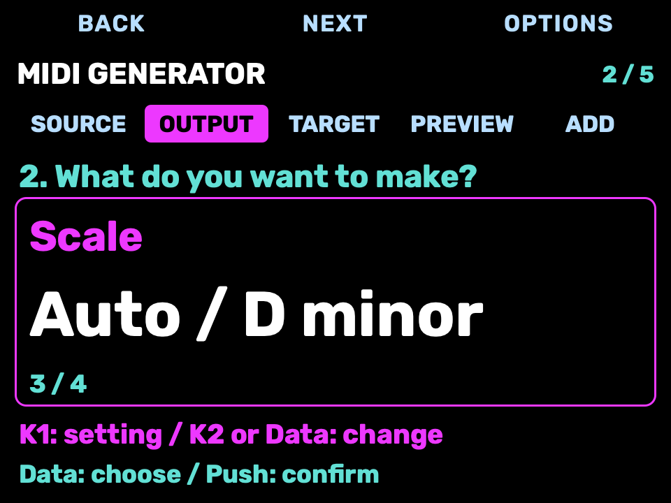

# Tape Workshop for MPC Sample

Tape Workshop is an independent community build based on **Melodee v0.5.1 by Kerem Kiliç (Ellic Studio)** for the Akai MPC Sample. All **26 instruments and effects**, including Melody Forge 1.0, are included.

## Download v184 for the SD card

[Download Tape-Workshop-v184-SD-Card.zip](https://github.com/bsauce42/tape-workshop-mpc-sample/releases/download/v0.5.1-tapeworkshop-community.184/Tape-Workshop-v184-SD-Card.zip)

**This is the only download needed for SD installation.** About 262 MiB, containing only:

- **autorun/** — the current Tape Workshop OS.
- **Melodee/Plugins/** — all 26 plug-ins, samples/resources, skins and required license notices.

No source archives, standalone guide ZIPs or development files are inside the SD download. [Release notes and other download methods](https://github.com/bsauce42/tape-workshop-mpc-sample/releases/tag/v0.5.1-tapeworkshop-community.184).

### Install

For MPC Sample firmware **1.3.0.12**:

1. Back up the SD card and matching plug-in folders; power off the MPC.
2. Extract the SD Card ZIP and replace the card-root **autorun** folder.
3. Merge the included **Melodee/Plugins** folders onto the card. Preserve projects, samples, user presets and other third-party plug-ins.
4. Eject the card, restart the MPC and reopen the companion at http://192.168.155.1/ after updating.

SD users do not need the separate **Signed-Update.zip** or source downloads. Signed Update remains for the existing browser updater/Manual Install; it changes the OS only and does not install plug-in folders.

## Main update: WAV → MIDI Generator

Turn a sample's estimated harmony into editable **Chords, Bass Line, Pluck,
Melody or Hybrid** parts, directly on the MPC. Choose genre, scale and rhythm,
preview a region, and add notes straight to the Roll. Hybrid is chords plus melody.

1. Load the source WAV on a sampler pad and set the correct project BPM.
2. Select a melodic instrument track, open **Roll**, push **Data**, and choose
   **MIDI GENERATOR**.
3. Follow **Source → Output → Target → Preview → Add**. Select **WAV sample**
   and the actual source track and bank/pad. They can differ from the destination.
4. Confirm the WAV pad: background analysis estimates its key. The Scale page
   shows a value such as **Auto / D minor**. The project key stays unchanged.
5. Choose **Generate notes**, then listen. **Add to Roll** offers **Cancel /
   Keep + Add / Replace** if notes already exist. Save your project.

**Data/K2** changes values, **Push/B2 Next** confirms, **B1 Back** returns,
**K1** selects a setting and **B3 Options** opens advanced controls. For simple
chords, enable **Triads** and disable **Sevenths/Ninths**. Whole Notes changes
rhythm, not chord size. WAV detection estimates harmony; it is not exact
transcription of every audible note.

[Full illustrated MIDI Generator instructions](docs/guide/wav-to-midi.md) ·
[Drum Generator: choose sounds and generate a beat](docs/guide/drum-generator.md) ·
[Download the complete updated Quick Start and Manual](https://github.com/bsauce42/tape-workshop-mpc-sample/releases/download/v0.5.1-tapeworkshop-community.184/Tape-Workshop-v184-Guides.zip)

## Also new in v184

- Automatic WAV key preview before note generation; explicit scales use the
  detected WAV root.
- Updated browser Quick Start and Manual with nine new UI screenshots.
- Drum Generator with genre/groove controls and guided kick/snare/hat selection.
- Tutorial recorder: **MPC only** omits the large live screen in new exported
  videos; **Screen only** omits the hardware. Smooth transitions remain.
- Dark plum browser file/plug-in rows with bright readable text.
- Strings, Orchestra, Guitar and Electric in the complete 26-plug-in library.

Refresh the browser after installing. Previous recordings are not modified.
Automatic Song Generator, Chop Generator and Final Cut/Logic export remain
removed. Manual Song Mode and native Chop remain.

## Live typed search

Open typed Sample Select search with **Shift + B1**. Results update from the first letter. Partial words and phrases work: **pia** finds Piano; **warm pia** finds Warm Grand Piano.

Names beginning with the first word you type come first. For **kick**, **Kick 01** and **Kick Deep** appear before **Kings Dog Kicks** and **Deep Kick**. Other matches remain below. **DONE** or **BACK** closes typing and keeps the filter; erasing all characters restores the normal list. Voice matching is unchanged.

## Other included features

- Melody Forge: four-layer synthesizer, 80 presets across Trap, HipHop, R&B, EDM and DnB, with a dedicated live UI and 21 control pages.
- Distinct plug-in faces, parameter pages, live stereo waveforms, spectra and meters; browser artwork for all 26 plug-ins; Data-knob presets and optional B2 preset menu.
- Second Spin idle-wake/Crackle fix and audio-driven cassette reels; Afterglow Piano hot-green theme; Room Grand 1.3.1 release-noise defaults.
- Roll MIDI import, selection, Shift + K3 zoom and fine splitting; expansion bank/pad import, cover art and eight-bank builder; Live Screen/Tutorial Mode, stereo recording, themes, startup lighting and signed updates.

Sub Foundry, Contour Comp and the enlarged Prism EQ retain their established layouts. Browser DAW/Studio remains removed. The separate Melodee plug-in UI installer is a different product.

## Verification and source

The complete SD ZIP passed checks of all 26 plug-in bundles, resources/licenses,
and the signed OS bytes and permissions. ARM64 build, harmony/MIDI checks,
recording-view composition, save recovery and manual links/assets passed.
The MPC is confirmed running v184 and serving the recorder fix; broader testing
of long recordings and different samples remains ongoing.

SD ZIP SHA-256: `17a1dcf5f7fa3bd51fa445a95323fd6ce94143cafbdecae533bce75943685a6f`

[Release files and notes](https://github.com/bsauce42/tape-workshop-mpc-sample/releases/tag/v0.5.1-tapeworkshop-community.184)
include the signed **OS-only** updater, named **OS and plug-in source archives**,
checksums and an optional offline guide. Use **Melodee-v184-source.tar.gz** and
**Tape-Workshop-v184-Plugins-Source.tar.gz** for source, rather than GitHub's
automatic archive of this distribution/documentation repository. The OS source
commit is `e21d6ba097b4f95c91b94b609158cebef18ba932`.

Tape Workshop by **bsauce42**, based on **Melodee by Kerem Kiliç (Ellic Studio)**.
Original copyright, AGPL and component license notices are retained in the
build and source downloads. This is an independent community project.
