# Tape Workshop quickstart

Tape Workshop is based on **Melodee by Kerem Kiliç (Ellic Studio)**.

This guide takes you from the release zip to a saved beat with a kit and a
plug-in instrument. For every page and control, read the
[user guide](GUIDE.md).

1. [Install](#1-install)
2. [Learn the controls](#2-learn-the-controls)
3. [Select a track](#3-select-a-track)
4. [Load samples into a kit](#4-load-samples-into-a-kit)
5. [Edit a pad](#5-edit-a-pad)
6. [Record a beat](#6-record-a-beat)
7. [Add a plug-in instrument](#7-add-a-plug-in-instrument)
8. [Save the project](#8-save-the-project)
9. [Exit Melodee](#9-exit-melodee)
10. [MIDI Generator: WAV, MIDI or project key](#midi-generator-start-here)
11. [Drum Generator](#drum-generator-start-here)

## 1. Install

You need:

- An Akai MPC Sample with firmware **1.3.0.12** or **1.4.0.7**. On any
  other firmware Melodee does not start and the stock app keeps running.
- On firmware 1.4: **Developer Mode** on, in the stock app's Settings on
  the **DEV ENHANCEMENTS (BETA)** page.
- A microSD card.
- The complete **Tape-Workshop-v<version>-SD-Card.zip** supplied with your release.

To install Tape Workshop:

1. Save your project, power off, and back up the card's existing `autorun`
   and matching plug-in folders.
2. Unzip the SD Card download and replace the card-root `autorun` folder and copy the included root `autorun.sh` file.
3. Merge its `Melodee/Plugins` folder with the card's plug-in folder. The
   complete build includes all **28 Tape Workshop plug-ins**, resources and
   licenses. Keep your projects, samples, user presets and third-party plug-ins.
4. Eject the card, put it in the MPC and switch on. The stock app starts
   first; on firmware 1.4, accept its prompt to run the card script, then Tape Workshop opens.

Firmware 1.4 uses 44.1 kHz and does not support USB camera Screen Mirror. The browser Live Screen is a separate display feature.

The **Signed-Update.zip** is an alternative **OS-only** browser update. It
requires physical **B3 / INSTALL** confirmation on the MPC and does not install
separate plug-in folders. Source archives are for your computer, not the SD card.

Melodee changes nothing on the MPC itself. To stop it from starting, delete
the `autorun` folder and `autorun.sh` from the card.

While Melodee runs, connect the MPC to a computer with USB-C and open
**http://192.168.155.1/** in a browser. The page installs plug-ins and
updates, moves files to and from the card, and holds this quickstart and
the user guide. To update Melodee later, see
[Update Tape Workshop](guide/projects-and-files.md#update-tape-workshop).

## Tape Workshop shortcuts

| Task | Steps |
| --- | --- |
| Import MIDI | Choose a track with a sound → Roll → **Shift + B3**, or Data push → **Import MIDI**. Choose a `.mid`; use **Replace MIDI** if the pattern already contains notes. |
| Zoom Roll | Hold **Shift + K3**. |
| Split a note | Focus it → Data push → **Split at Cursor**. K2 sets the increment; Data moves the cursor; B1/Data splits; **B2 Done** finishes. |
| Select all notes | Data push in Roll → **Select All**. |
| Choose a theme | **Shift + Pad 8** → **SCREEN → Workshop theme**. Try **Tape Workshop Neon** for black, bold white and purple/magenta. |
| Import a pad | Empty track → **Import Pad**, or Menu → HERE → **EXPANSIONS**. **Empty Pad** starts without a sample. |
| Build an expansion | Browser → **Expansion Builder** → banks A–H → add WAVs/cover → **Save to MPC** or **Download a copy**. |
| Record a tutorial | Browser → **Tutorial Mode** → **Enable MPC audio** → **Record Tutorial** → stop → **Save recording**. |

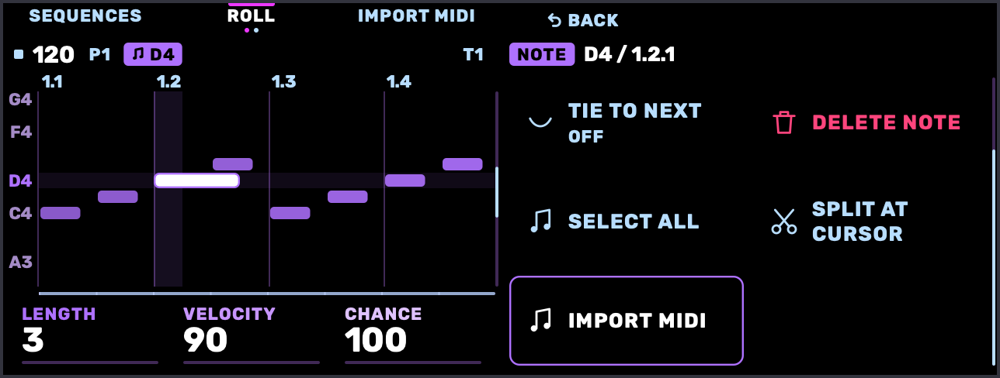

Native UI renders with demo notes; left shows Shift + B3, right shows the Import
MIDI action. [Detailed Roll controls](guide/roll-note-tools.md) ·
[All theme previews](guide/workshop-themes.md) ·
[New-feature guide](guide/tape-workshop.md).

The browser companion has a black logo-color theme. **Studio/the browser DAW is
removed**; edit and arrange on the MPC. On iPhone, open the numeric address in
Safari and choose **Share → Add to Home Screen**. The shortcut still needs the
MPC's USB connection. [Browser guide](guide/web-studio.md).

## 2. Learn the controls

The printed buttons keep their MPC meaning. The jobs printed under the pads
are **SHIFT** + pad, as on the stock app. The map below shows what each
button does in Melodee.

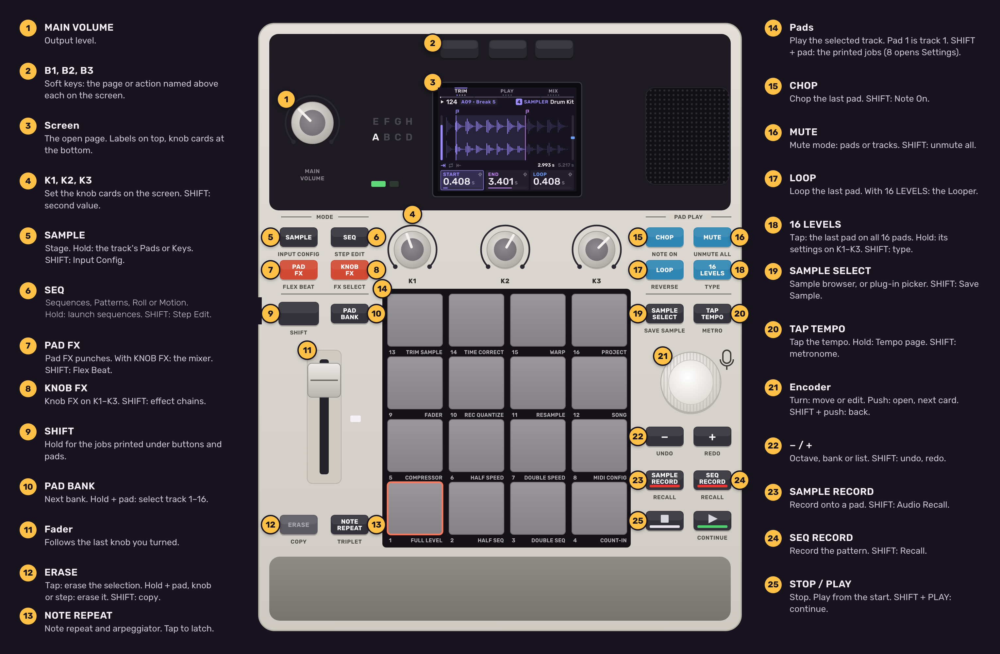

Every page uses the same layout:

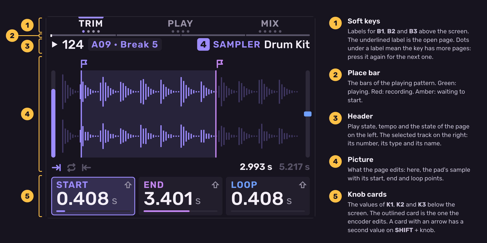

These controls work the same on every page:

| Control | Action |
| --- | --- |
| **B1**, **B2**, **B3** | Select the page or action named above each key. |
| **K1**, **K2**, **K3** | Set the value on the card above each knob. |
| Encoder (turn) | Move through a list, or fine-tune the outlined card. |
| Encoder (push) | Open the item under the cursor, or move to the next card. |
| Encoder (hold) | Open the **Menu**: the page's jobs (**HERE**) and the 16 places (**GO**). |
| **SHIFT** + encoder push | Go back one page. |
| **SHIFT** + **−** / **+** | Undo / redo. |

Melodee starts on **Full**, which shows every page. **Basic** shows the
stock app's pages plus tracks, plug-ins, the mixer and Song. To switch, press
**SHIFT** + **Pad 8** (Settings) and turn **K1** (**FEATURES**). See
[Basic and Full](guide/settings.md#basic-and-full).

Melodee has four short lessons. Hold the encoder, press **B3** (**GO**),
then pad 16 (**LEARN**). See [Lessons](guide/basics.md#lessons).

## 3. Select a track

Melodee has 16 tracks, one for each pad. Pad 1 (bottom left) is track 1.

To select a track, hold **PAD BANK** and press a pad. This works on any
page.

A new project has no tracks. It opens on track 1 with the track types, so
you choose what it is first ([step 4](#4-load-samples-into-a-kit) makes it a
kit). The other tracks stay empty until you choose what they are (see
[step 7](#7-add-a-plug-in-instrument)).

To see all tracks as a mixer, press **PAD FX** and **KNOB FX** together to
open **Tracks**.
Each cell shows a track's number, its pattern, its type and its level. Use
**K1** to set the selected track's level, **K2** its pan and **K3** its send
to bus A.

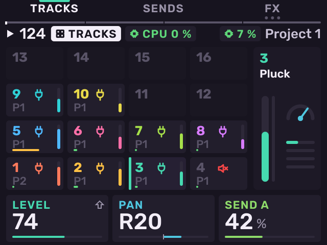

## 4. Load samples into a kit

Melodee reads WAV (16, 24 or 32-bit), MP3, FLAC, Ogg Vorbis and AIFF files (any sample rate;
a WAV up to 6 hours) from `Melodee/Samples` on the card, or anywhere else on it. It can
also read the MPC's internal factory samples.

1. Select track 1 (hold **PAD BANK**, press pad 1). In a new project it
   shows the track types.
2. Turn the encoder to **Drum** and push it, then push it on **Card**.
   Track 1 is now a kit, and the sample browser opens. On a track that is already a
   kit, press **SAMPLE SELECT** to open the browser.
3. Turn the encoder to move through the list. Push the encoder to open a
   folder. Press **B1** to go back out of a folder.
4. Press **B2** to switch between the card (**CARD**) and the MPC's
   factory samples (**INTERNAL**).
5. Press **B3** to turn on **PREVIEW**. Each file plays when you move to it.
   **PREVIEW** stays on until you turn it off.
6. Hit the pad you want to load onto, then push the encoder on a file. The
   file loads onto the last pad you hit.

To load a file onto the next empty pad, hold **SHIFT** and press any pad.

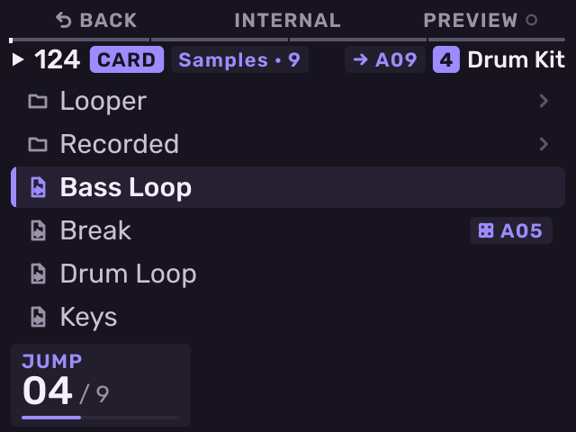

The browser also loads SFZ, MPC programs and expansions, EXS24, SoundFont
and DecentSampler instruments onto a pad. See
[Sampled instruments](guide/kits-and-sampling.md#sampled-instruments).
Push on an MPC kit to open **LOAD KIT**: it loads the whole kit, or only the
banks you pick. See [Loading samples](guide/kits-and-sampling.md#loading-samples).

## 5. Edit a pad

Press **SAMPLE** to open **Stage**. Stage holds the quick pages of the
selected track. On a kit, these are the stock Sample mode pages for the last
pad you hit.

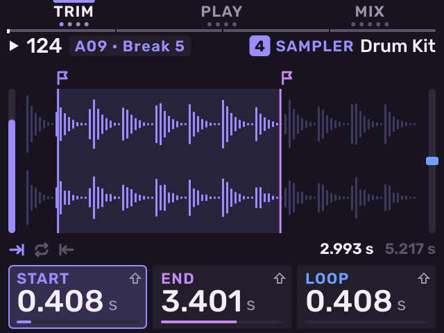

- **B1** cycles **TRIM**, **LAYERS**, **TUNE** and **AMP ENV** (on a sampled
  instrument: **ZONES**, **TUNE** and **AMP ENV**).
- **B2** cycles **PLAY**, **COLOUR**, **FOLLOW** and **CLOUD**.
- **B3** cycles **MIX**, **SENDS**, **FILTER**, **FILT ENV** and **KIT FILT**.

Press the lit key again to go to its next page. The dots under a key show
which page of its cycle is open.

In Basic, a kit pad has the stock app's seven pages: **TRIM**, **TUNE** and
**AMP ENV** on **B1**, **PLAY** on **B2**, and **MIX**, **FILTER** and
**FILT ENV** on **B3**. Full adds the other pages.

On **TRIM**, use **K1** to set the start point, **K2** the end point and
**K3** the loop point. Hold **SHIFT** and turn a knob to zoom in at that
point.

To chop a sample into slices, press **CHOP**. See [Chop](guide/kits-and-sampling.md#chop).

## 6. Record a beat

1. Press **SEQ** to open **Sequences**. If Patterns, Roll or Motion opens
   instead, press **B1** (**SEQUENCES**). The bank's 16 sequences are laid out as
   the pads: pad 1 bottom left. A sequence keeps one pattern for each
   track.
2. Hold **SEQ** and use **K1** to set the pattern length in bars and **K2**
   the grid (Q) of the selected track's pattern. **K3** sets the swing of
   the project.
3. To change to another sequence, press its pad. Pad 1 is sequence 1. Every
   track goes to the pattern that sequence keeps. A new sequence keeps
   nothing: the tracks play on until you launch a pattern. On other pages,
   hold **SEQ** and press **SHIFT** + a pad.

   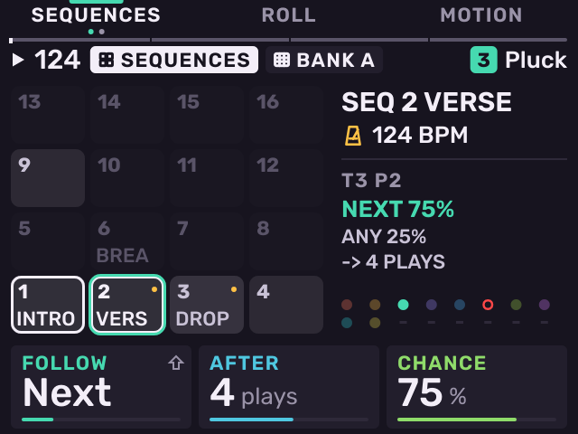

   To put one track on another pattern, press **B1** again for
   **Patterns**. Its pads are the selected track's patterns. On any page,
   hold **SEQ** and press a pad for the same. The sequence you are on keeps
   the pattern you launch.

4. Press **SEQ RECORD**. The button flashes and the screen shows that
   recording is armed.
5. Press **PLAY**. Recording starts. Play the pads.

   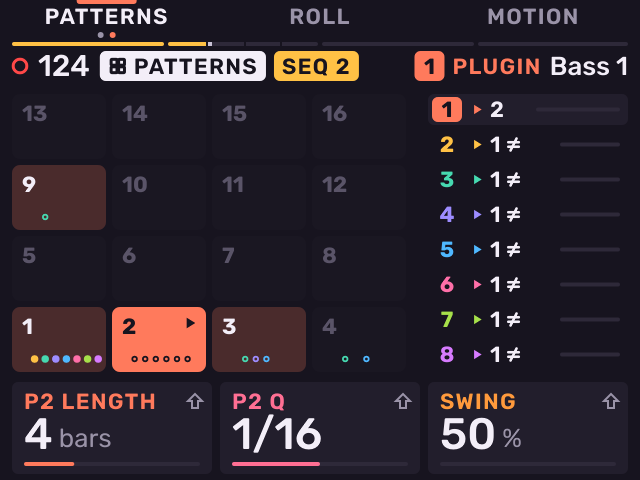

6. Press **SEQ RECORD** again to stop recording. Playback continues.
7. Press **STOP** to stop.

Each take is one undo step. Press **SHIFT** + **−** to undo it.

Recording options:

- **SHIFT** + **Pad 4**: turn the one-bar count-in on or off.
- **SHIFT** + **Pad 10**: turn **Rec Quantize** on or off. It is on at
  first: recorded notes land on the pattern's Q.
- **SHIFT** + **TAP TEMPO**: set the metronome to Off, On or Rec.

To edit the notes, press **B2** (**ROLL**) for the piano roll, or **SHIFT** +
**SEQ** for **Step Edit**. In Step Edit, press **SHIFT** + **B1** (**PADS**)
for **STEPS** mode: each pad sets or clears a step of the bar. On a kit,
STEPS edits the last pad you hit.

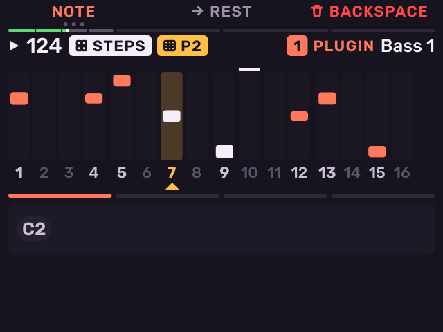

## 7. Add a plug-in instrument

Melodee loads VST3, LV2, CLAP and VST2 instruments built for the MPC's ARM processor,
including the Melodee Poly, Melodee PD and Melodee Chip synths. Put them in
the `Melodee/Plugins` folder on the card first (see [step 1](#1-install)). The
Melodee synths are free downloads; see [Plug-ins](guide/plug-ins.md).

1. Hold **PAD BANK** and press pad 2 to select track 2.
2. The track is empty, so Stage opens with the track types, as on the MPC:
   **Drum** (an empty kit, samples from the card, or a recording),
   **Keygroup** (an instrument played across the keys), **Plugin** (a
   plug-in instrument), **MIDI** (an external instrument on the MIDI Out
   jack or USB) and **Audio** (a recording of the input).

   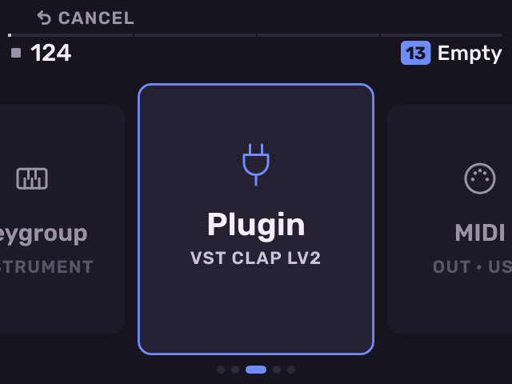

3. Turn the encoder to **Plugin** and push it. The plug-in picker opens on
   the `Melodee/Plugins` folder.
4. Turn the encoder to a plug-in and push the encoder to load it.
   Plug-ins that cannot run on the MPC are dimmed. Once it loads, Melodee
   goes back to the page you were on.

   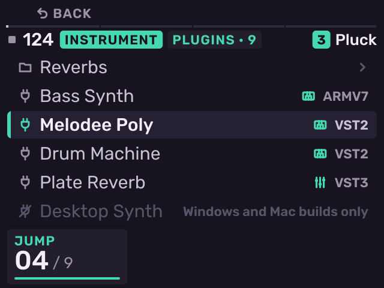

5. Press **SAMPLE** to open Stage, and play the pads. To set the key and
   scale the pads play in, hold **SAMPLE** to see **Keys** and turn **K1**
   for the root, **K2** for the scale and **K3** for the pad layout. Press
   **−** / **+** to change the octave.

   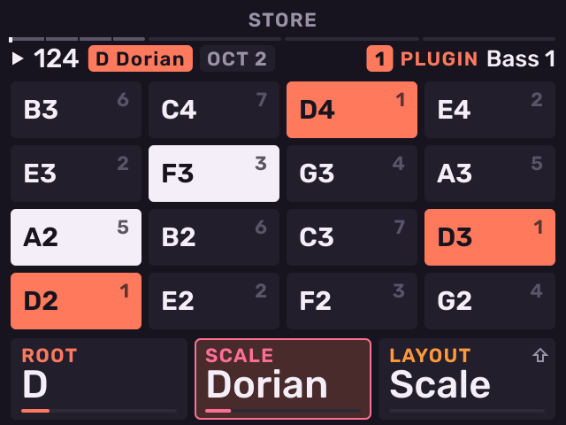

6. Press **SAMPLE** again for **PRESETS**, the first page of **B1**. Turn
   the encoder to step through the plug-in's presets, or push it for the
   whole list. **K1**–**K3** are **FILTER**, **ECHO** and **SPACE** on
   every plug-in.

   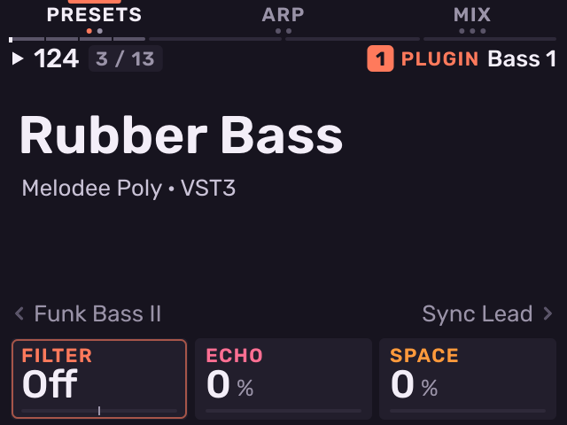

7. Press **B1** for **EDIT**, its next page: the plug-in's own parameters
   come on **K1**–**K3**, in rows of three. Turn the encoder to move through
   the rows, and press **−** / **+** for the plug-in's page before or after.

   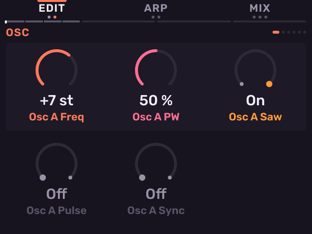

Record the plug-in track the same way as the kit in
[step 6](#6-record-a-beat).

## 8. Save the project

Melodee saves the project by itself, three seconds after you last used a
control while nothing plays. A new project is saved as **Project 1**,
**Project 2** and so on. To give it a name of its own:

1. Press **SHIFT** + **Pad 16** to open **Project**.
2. Press **B1** (**SAVE AS**).

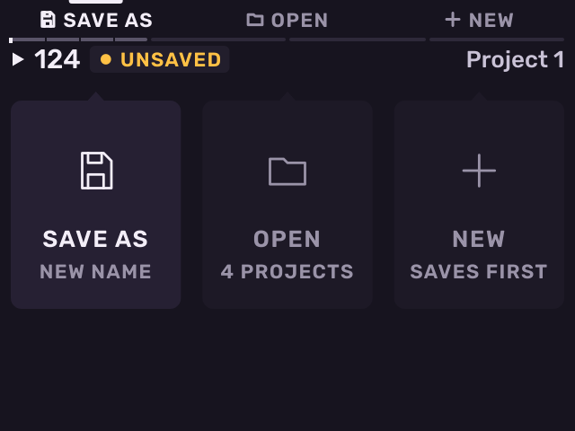

Melodee asks for a name. The pads type like phone
keys: each pad shows the letter it types next. Pad 14 types a space, pad 15
switches to digits and pad 16 deletes. Turn the encoder to move the cursor.
Press **B3** (**SAVE**) or push the encoder to save. Press **B1** to cancel.

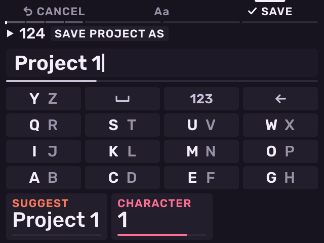

Projects are saved in `Melodee/Projects` on the card. To open another
project, press **B2** (**OPEN**) on the Project page.

## 9. Exit Melodee

Press **POWER** briefly. The Exit screen opens:

- **B1** (**STAY**): go back to Melodee.
- **B2** (**POWER OFF**): save the project and switch the MPC off.
- **B3** (**MPC APP**): save the project and go back to the stock app until
  the next time the MPC is switched on.

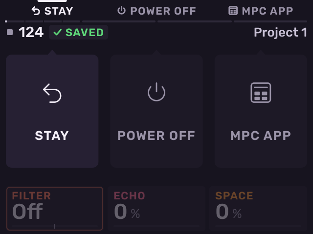

When Melodee starts again, it opens the project you had open.

## Next steps

- [Coming from the stock MPC Sample](guide/coming-from-the-stock-mpc-sample.md):
  what is the same and what is different.
- [Sequencing](guide/sequencing.md): patterns, sequences, Roll, Step Edit and
  parameter locks.
- [Song](guide/song.md): arrange patterns and export a mixdown or an MPC 3
  project.
- [Keygroup tracks](guide/instrument-and-midi-tracks.md#keygroup-tracks) and
  the auto sampler, which samples a plug-in or an external instrument.
- [Audio tracks](guide/audio-tracks.md): record the input into a pattern.
- [Chord progressions](guide/instrument-and-midi-tracks.md#chord-progressions):
  hold **16 LEVELS** and press **B2** (**CHORDS**).
- [Looper](guide/looper.md): press **LOOP** and **16 LEVELS** together (in
  Full).
- [Effects](guide/mixer-and-effects.md): effect chains, Knob FX and Pad FX.

### MIDI Generator: start here

1. Select a melodic instrument track with a sound, open **Roll**, push **Data**
   for Roll Actions, and choose **MIDI GENERATOR**.
2. **Source:** choose **Project key / scale** to start without a file,
   **WAV sample** for a loaded WAV, or **MIDI Roll** for existing/imported notes.
3. **Output:** choose **Chords, Bass Line, Pluck, Melody or Hybrid**. Hybrid is
   chords plus melody. Pick Genre, Scale and Rhythm.
4. **Target:** select the instrument track that should play the new notes.
5. **Preview:** choose **Generate notes**, press Data, then **Listen to rhythm**.
6. **Add:** choose **Add to Roll**. Existing MIDI offers **Cancel / Keep + Add /
   Replace**. Save the project.

**Data/K2** changes values, **Push/B2 Next** confirms, **B1 Back** goes back,
**K1** selects a setting and **B3 Options** opens advanced controls.

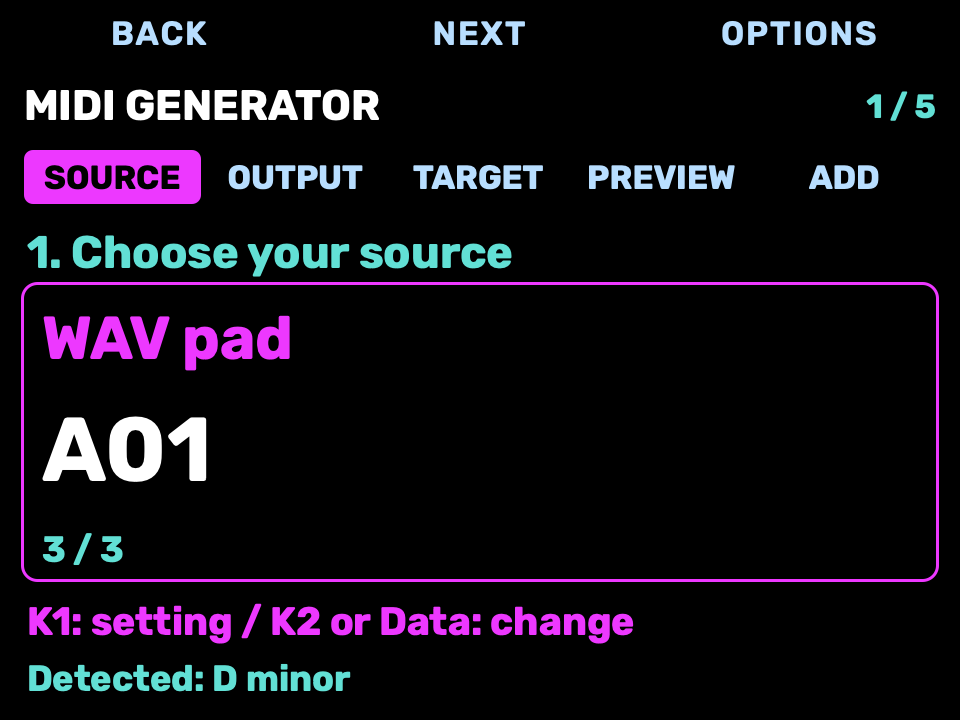

For WAV input, remember the actual source track and bank/pad. Set tempo first.
**From v182**, confirming the WAV pad starts automatic background key detection;
Scale shows an estimate such as **Auto / D minor**. Project key is unchanged.
Specific scale choices use that detected WAV root. Earlier builds detect the key
when you run Generate notes. The estimate is not exact note transcription.

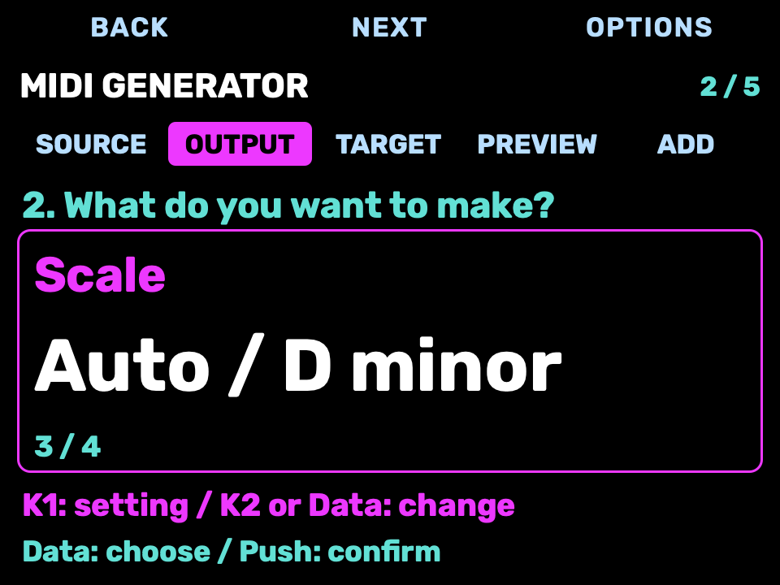

For simple three-note chords, use **Options → Triads ON, Sevenths OFF,
Ninths OFF**. Whole Notes changes timing, not the number of notes in a chord.
For single-note parts choose Bass Line or Melody. Follow is available only for
WAV/MIDI sources; Project key / scale has no Follow setting.

[Full MIDI Generator instructions](guide/wav-to-midi.md) ·
[Drum Generator walkthrough](guide/drum-generator.md).

### Drum Generator: start here

Open a **drum kit track's Roll → Data → DRUM GENERATOR**. Choose style settings,
then use **Pads** to load/map kick, snare and hats in the displayed order.
Preview the rhythm, then review **Keep + Add / Replace** before adding it.
The first version supports **4/4**. The generator creates note events; loaded
samples provide the sound.

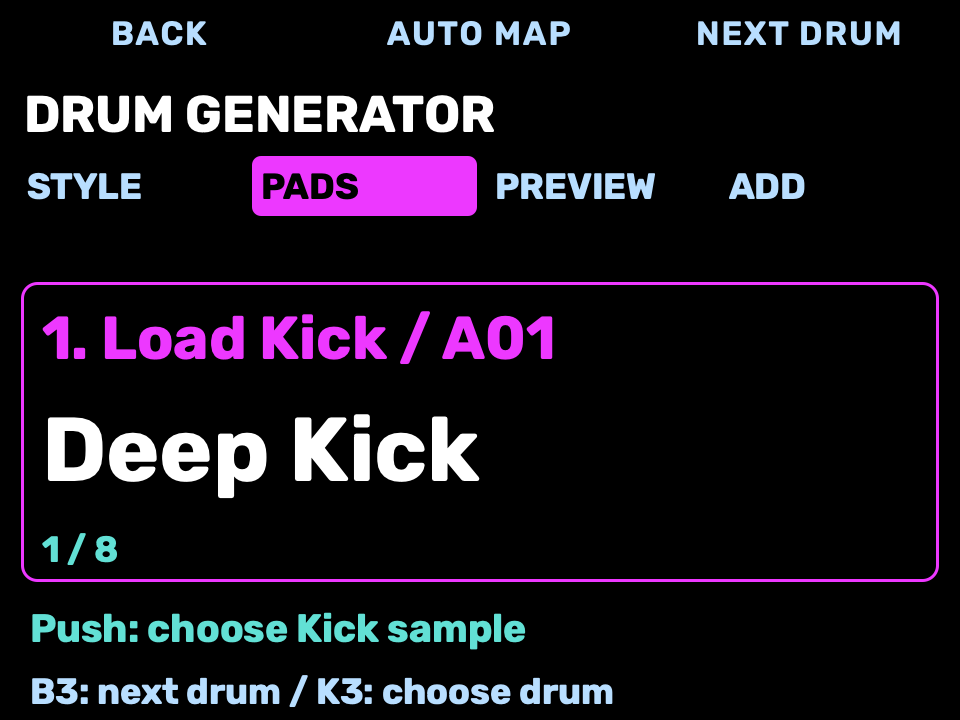

### Bass rhythms (v143)

At **Output**, choose **Bass Line**, then Push/Next to **Bass rhythm**. Turn
Data to choose a groove, then continue to Target and Preview. **Listen to bass
rhythm** plays up to two bars from the selected region, following chord changes.
K3 selects the starting region. It uses your target instrument's sound; choose
an 808/bass preset there for that timbre. The rhythms themselves are editable MIDI.

Rhythms: Style Default, Whole Notes, Half Notes, 1/4, 1/8, 1/16, 1/8 Triplets,
Classic 808, Trap 808, Syncopated, Offbeat, Charleston, Tresillo 3-3-2,
Dotted + Pickup, Half Whole Half, Whole Half Half, Half Whole Classic,
Last 1/8 Pickup, Long Short, Two Short Long, Short Long, Gallop,
Every Measure and Two-Bar Motion.

**Options > Bass Rhythm** also changes this setting. Bass Style still chooses
roots, root/fifth or octave movement; **Style Default** retains the old timing.
Gate controls note length; 100% gives full lengths, lower values shorten them.
Fixed note divisions use quarter-note timing. Named grooves lock to the project
measure; two-bar patterns repeat over two measures. Long/short names describe
4/4 phrases and scale with measure length in other meters. Every chord change
starts its new root and clips the preceding note; extra groove hits keep their
measure positions. Recognition from WAV remains an estimate. Add to Roll and
optional MIDI export use the same notes; Keep/Replace/Cancel protection remains.

### Bar chords, octave edits and visible tempo choices (v144)

**Roll > Actions > SELECT BAR**: turn Data to choose a measure. Push selects
its intersecting notes, including notes held across its boundary. B2 opens chord
choices for that bar. Choices use only tones in the project Root/Scale; Data or
B3 chooses another, Push auditions. B2 reviews, then B2 confirms replacement of
only the selected bar. Notes outside it, including held-note tails, are preserved.
One Undo restores the old notes. Chord generation requires a melodic plugin,
keygroup or MIDI track. For a different key, change the project Root/Scale first.

**Roll > Actions > NOTE OCTAVE**: Data chooses -4 to +4 octaves; B2/Push applies
once with Undo. With a selected bar, only that bar's note portions shift. Without
one, the marked notes (or focused note) shift. Out-of-range notes or collisions
are refused together. Plain drum pad numbers are not transposed: open a pitched
pad Roll first. The sampler's existing -48..+48 pitch range is respected.

**MIDI Generator > Output > Bass Line** now asks for Rhythm and Octave. Choose
C0 Extra low, C1 Low 808, C2 Standard or C3 Upper. The default remains C2; the
instrument supplies the 808 timbre. MIDI C0 is note 12, C1 note 24.

**Sample Select > Auto BPM**: after loading a rhythmic WAV on a sampler track,
the tempo dialog visibly offers Use WAV BPM, Time Warp Sample, Keep Original.
Data chooses; B2 or Push applies; B3 previews (Shift+B3 warped). Use WAV BPM
sets the normal project/sequence tempo to the detected value without warping the
sample. Auto BPM is toggled with Shift+B3 in the normal browser. A sample with
no steady beat cannot provide a reliable detected tempo.

The release startup now copies and verifies the bundled voice decoder/model into
the runtime voice folder before starting. Voice search remains keyword based;
the vocabulary does not include every English word. Hold Shift+B2, say a supported
sample keyword, then release. Stop playback/monitoring first.

### Sample Select knob layout (v145)

In the normal sample browser, **K2 AUTO BPM** turns automatic BPM detection
OFF (left) or ON (right). K3 carries search SCAN RUN/PAUSE when available.
Shift+B3 remains an Auto BPM shortcut. During the detected-tempo dialog, K3
still adjusts sequence tempo; expansion-bank and MIDI import controls stay
context-specific. The K2 assignment is retained while Knob FX is active.

### Strings and Orchestra output level (v145)

Strings 0.4.1 and Orchestra 0.2.1 raise output by about 9.5 dB before the existing
soft ceiling. The Output knob and saved parameter values are retained; existing
sounds play louder, so rebalance Output against the other tracks. The full SD ZIP
includes both updated plug-ins. The signed OS-only updater does not replace plug-in
files: install their plug-in updates too, then reload the instrument/restart.

Tape Workshop v147 adds **Roll > Data Push > Drum Generator** on a sampler
kit track in 4/4. Choose Style, map loaded Drum Pads, Preview, then Add with
an explicit Keep/Replace choice. K1 field, Data/K2 value, K3 drum role.
B2 generates variations; lock lanes on Pads to keep their rhythm. Includes
28 genres and 1–16 bars. See Kits and Sampling for the complete workflow.

v149 adds the same 28 genres to musical MIDI generation: Output > Genre >
Rhythm. Choose Genre Auto for styled timing, or select a rhythm to override it.
Original keeps the old behavior. Applies to Chords, Pluck, Melody and Hybrid;
project key/scale, preview, MIDI export and Keep/Replace workflow stay in place.

v150 adds Scale to Output > Genre > Scale > Rhythm. Choose an explicit scale
for Chords, Melody, Pluck or Hybrid; it uses the project root and keeps generated
notes in that scale. The default retains Project/Auto source behavior. Generate
Again remembers the scale. Enable Triads if no compatible chord is available.

v151 makes MIDI/Drum Generator settings one screen each with large bold values.
K1 selects the setting; Data/K2 changes it; Next/Back walks the setup. In Drum
Pads, K3 selects a role; Push or Sample Select opens its audio browser and returns
after loading, retaining your generated beat and settings.

The Preview page shows all eight drum lanes together. K3 selects a lane;
K1 or Data selects a two-bar window anywhere in the generated loop. Push
plays/stops that window. K2 mutes/unmutes the selected lane. Hold Shift:
B1 toggles Mute, B2 regenerates only the selected unlocked lane, and B3
locks/unlocks it. Normal B2 generates a new full beat while preserving locked
lanes. Muted lanes keep their hits but are omitted from preview and Add.
B1 returns to the sound picker workflow; B3 advances to Add with Keep/Replace.

### MIDI and Bass generator preview

Source selection is unchanged: Project Key/Scale, MIDI Roll (including a chosen
pitched pad), or a loaded WAV pad using whole-WAV analysis. Preview now shows
four chord cards around the selected region and a harmonic voicing map. Bass
uses its own title, note-name cards, root map, octave and rhythm summary. The
bass map shows harmonic roots, not every rhythmic bass hit. Generated rhythm
notes remain visible and editable in the Roll after Add. Data chooses actions,
Push runs them and K3 selects a chord region. Keep/Replace confirmation remains.

### Arrange patterns in Song Mode

Press **SHIFT + Pad 12** to open Song. Select a track with its pad, move to a
bar with Data, choose P1/P2/etc with K2 and clip length with K3, then B3 Place.
On an existing clip, K2 changes its pattern and B2 mutes/unmutes that clip.
The automatic Song Generator has been removed; saved arrangements remain.

### Browser tutorial audio level

Enable MPC audio before recording. The browser captures the fixed stereo master
mix before the MPC main volume knob, so turning down local speakers/headphones
does not quiet the tutorial recording. Track levels, pan, effects and the master
compressor still affect the recorded mix. This uses the existing fixed-mix output,
not a second instrument render; the USB volume preference still works normally.

Use **Pause recording** in Tutorial Mode or Live Screen to skip a section, then
**Resume recording** to continue the same video. The live view, monitoring and
MPC keep running; paused time does not count toward the take limit. **Pause view**
only holds the display when you are not recording.

### Capture workspace

Tutorial Mode and Live Screen use a dark viewer with a settings inspector on the
right and a compact silver recording toolbar above the viewer. The dark timer
shows recorded time and pauses with capture. Tutorial inspector tabs are
**Transform**, **Appearance** and **Playback**. The phone layout wraps the recording
toolbar above the viewer and places the inspector beneath it. These changes
only affect the browser controls; your exported video retains its selected look.

In **Appearance**, select **White studio room** for a lit wall/floor background
and soft screen/MPC shadows, or **Flat background** for your chosen color. The
scene is included in the recording. Choosing a Background color automatically
switches to Flat background and updates the preview and recording; select White
studio room again to restore the room. **Tablet** fits the 4:3 screen without side
bars; zoom, pan and 3D angle controls remain available.

**Screen clarity → Smooth edges** softens blocky edges when the live display is
enlarged or angled, including the recorded output. **Original pixels** preserves
the source pixel grid. The MPC feed remains 320 × 240; 1080p output does not add
missing source detail.

### Your own background image

In Tutorial Mode choose **Appearance → Upload background**; in Live Screen use
**Upload background** in the inspector. Choose a PNG, JPEG or WebP (up to 8 MB).
The image switches the scene to **Uploaded image** and is included in recordings.
**Fill frame** fills the picture with a centered crop; **Fit whole image** shows
the complete image over your chosen background color. The browser remembers
the image and framing for both modes. **Remove image** clears it.
Images stay in your browser and are resized to fit 1080p recording. If browser
storage is full, the uploaded image remains available for that session.

### Animated backgrounds

Choose **Appearance → Scene** in Tutorial Mode, or **Scene** in the Live Screen
inspector. **Neon City** has rain and passing lights; **Warehouse Light** has
drifting dust and light beams; **Prism Waves** has slow purple/cyan light curves.
**Pixel Sunset**, **Pixel Space** and **Pixel Arcade** add animated retro scenes.
**Neon Scope**, **Ember Spectrum**, **Spectrum Ribbons**, **Pulse Cubes** and
**Neon Tunnel** add audio-reactive spectrum, curves and 3D geometry.
These are original Tape Workshop designs without outside artwork or watermarks.
**Animate background** pauses/resumes the scene independently of recording.
Reduced-motion preferences disable animation initially; you can enable it.
Enable **MPC audio**, then leave **React to MPC audio** checked for level/bass/
frequency response. The backgrounds idle without audio; frequency bars and cube
heights respond to analysed audio rather than a simulated meter.
**Live audio waveform** shows both channels in a protected strip below the logo.
It is flat without direct MPC audio and can be hidden independently. The waveform
and background response are included in recordings.
Background motion runs on the browser device; it adds no MPC audio processing.
Choosing a Background color switches back to Flat background.

### Long tutorial recordings

Tutorial recording supports up to two hours in one file with browser disk
buffering. Keep the page visible and the device awake. Allow roughly 1.9 GB
per hour at 1080p or 1 GB at 720p, plus browser working space. Storage and
browser limits can stop a take earlier; the application file guard is about
3.94 GiB. Disk buffering avoids accumulating the full take in JavaScript
memory. Without it, the page explicitly uses the previous 20-minute/768 MB
short mode. Save the take before starting another one.

After Stop, use Save recording. Supported Save As browsers stream chunks to
your chosen file with a percentage indicator; other browsers download one
combined video. Large takes skip the inline video preview. Temporary browser
buffering is not a backup: keep the page open until you have saved the file.
Two-hour limits and chunk persistence are tested with simulated chunks; a
full two-hour device/browser recording has not yet been validated.

## Track, bank and pad mixer (community v197)

Press **Pad FX + Knob FX together**, or **hold Data → GO → MIXER**.
Turn Data to select a track, press it for its bank mixer, then press on a
pad for Pad Details. Tap Pad Bank to cycle A–H. **B1 Back**, **B2 Mute/Solo**,
**B3 FX**. On strip pages, **K1 channel, K2 level, K3 pan**. Select the
master strip and press Data for master level, balance, and mono/stereo.
See [the complete controls](guide/tracks.md#the-tracks-page).
