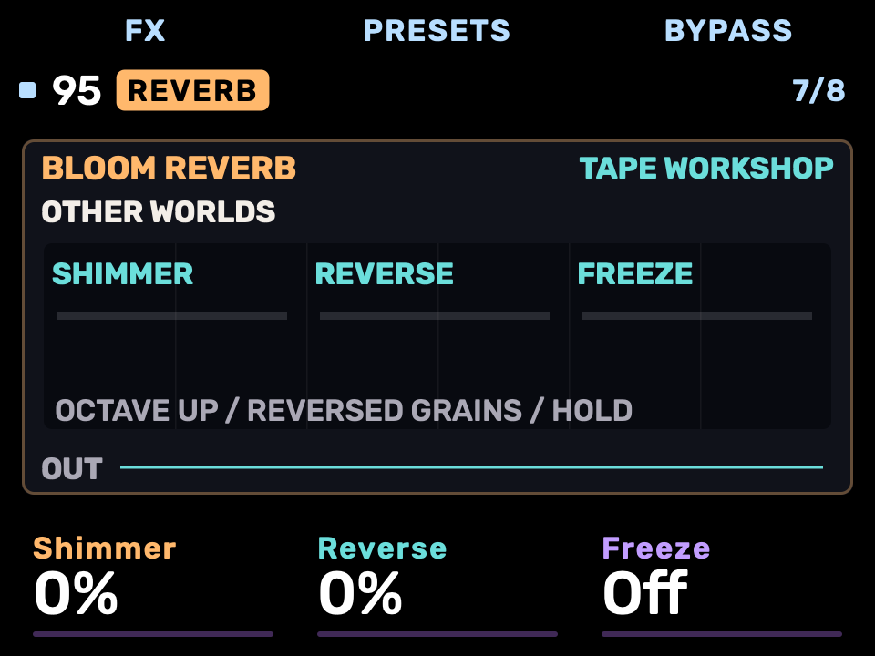
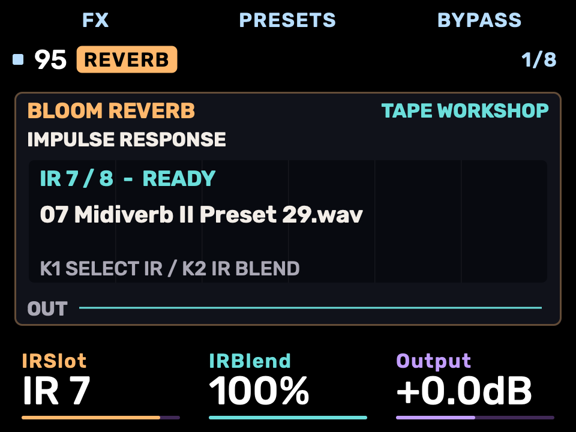

# Bloom Reverb

A native stereo reverb for MPC Sample / Tape Workshop OS. Original algorithmic
DSP, frequency-dependent decay and optional user IR convolution. Independent of
FabFilter: it does not reproduce Pro-R 2's proprietary algorithms or presets.
Host based on Melodee by **Kerem Kiliç (Ellic Studio)**. AGPL-3.0-only.

## Eight parameter pages

K1–K3 adjust the three parameters on a page. Navigate pages using the host's
usual page controls. Data selects factory presets directly, with the preset
menu still available. Save the project or a host preset to retain settings.

1. IR Slot (Algorithmic / 1–8), IR Blend, Output (−12 to +12 dB). The selected WAV filename and load status appear in the main panel as K1 changes the slot. Long filenames scroll at readable size.
2. Space, Decay (0.25–30 s), Mix.
3. Brightness, Character, Distance.
4. Pre-delay (0–250 ms), Width (0–200%), Early/Late balance.
5. Low, Mid, High decay multipliers (25–200%): frequency-dependent tail shaping.
6. Low cut (20–800 Hz), High cut (1–20 kHz), post-reverb Tilt EQ.
7. Shimmer (octave-up grains), Reverse (backwards grains), Freeze (hold tail).
8. Modulation rate, Motion depth, Diffusion.

The IR-first page order requires Tape Workshop v188 or newer; the plug-in also
requires version 0.1.1 for full filenames. Existing parameter IDs and saved preset
chunks remain compatible. The standard VST2 short parameter display stays within
its original size; filenames use a separate bounded UI-only metadata query.

The space/decay and EQ diagrams show control responses. The small output trace
uses measured audio and stays flat at silence. Eight original page layouts are
part of the matching Tape Workshop OS update; older compatible hosts can still
show generic parameter controls.

## Bigger and stranger

Try Dark Cathedral, Infinite Bloom, Ghost Reverse, Shimmer Cloud, Metal Tunnel,
Frozen Orbit, Distant Cosmos, Plate Mirage, Drum Chamber or Vocal Halo.
Freeze captures a tail that is already sounding; start with audio, then engage
Freeze. Long decay, shimmer and reverse can overlap densely: reduce Mix/Output
as needed. Algorithmic reverb works fully without any IR files or computer.

## User impulse responses

Copy your own or licensed WAV IRs into this plug-in folder's **IRs/** directory
on the SD card, then reload the plug-in. The first eight files in alphabetical
order become slots 1–8; select IR Slot and wait for IR Ready. IR Blend crossfades
algorithmic and convolution sound. Space/Decay and the creative tail controls
shape the algorithmic branch; use a partial IR Blend for a long hybrid tail. Missing, silent, invalid or oversized IRs
show No IR / Bad IR and fall back to the algorithmic engine.

Supports mono/stereo PCM16, PCM24, PCM32 and float32 WAV; stereo is dual mono,
not four-channel true-stereo convolution. Input rates 8–192 kHz are resampled to
the active plug-in rate. The budget is **96,256 resampled frames** (about two
seconds at 48 kHz, or one second at 96 kHz). Longer IRs are rejected, not silently
trimmed. The partition pipeline adds **1,024 samples of wet-path latency** (21.3 ms at 48 kHz);
the dry path has no added delay. Pad timing and MIDI are unchanged.

IR loading and FFT preparation happen on a worker, never in the render callback.
Buffers, two IR banks and convolution history are bounded; rendering allocates
no memory and does no file I/O or locking. The build supports host sample rates
8–96 kHz. Sample rate changes require the host's stopped/reconfiguration path.
Mac benchmarks are development checks, not measured MPC CPU figures. Profile
on the unit before relying on multiple long-IR instances while recording.

Screenshots are native UI renders with the factory defaults; the flat output
trace represents silence, rather than simulated audio.

## Build

`python3 plugins/tape-workshop-bloom/build.py` creates the Linux ARM64 bundle
under `build/tw-bloom-card/Melodee/Plugins/`. The build uses the existing thin
VST2 ABI, without the withdrawn SDK. This is an effect with two audio inputs and
outputs, not an instrument. Add Bloom Reverb in a track/pad/bus effect slot.
