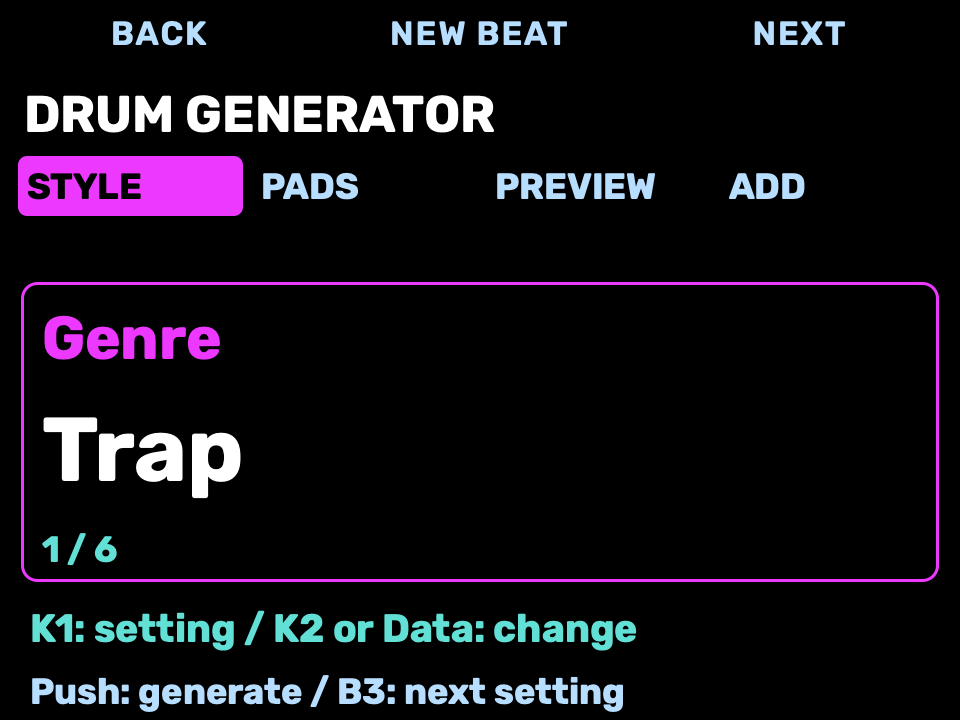
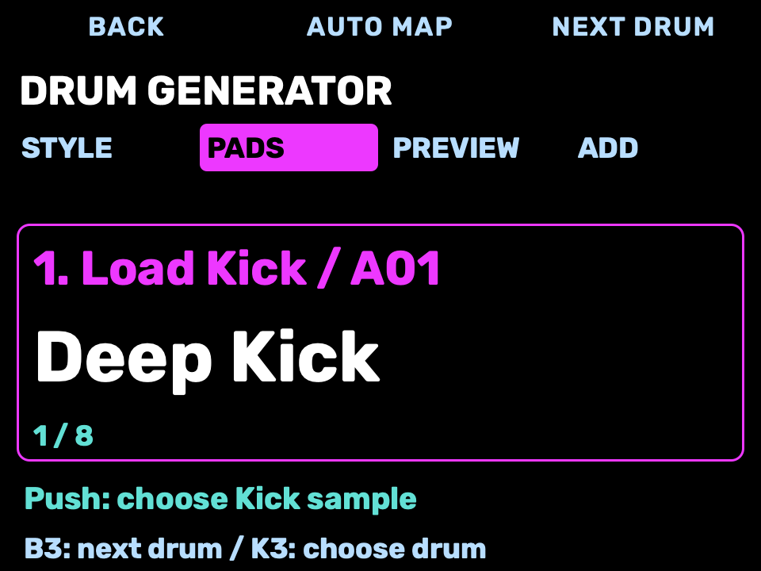
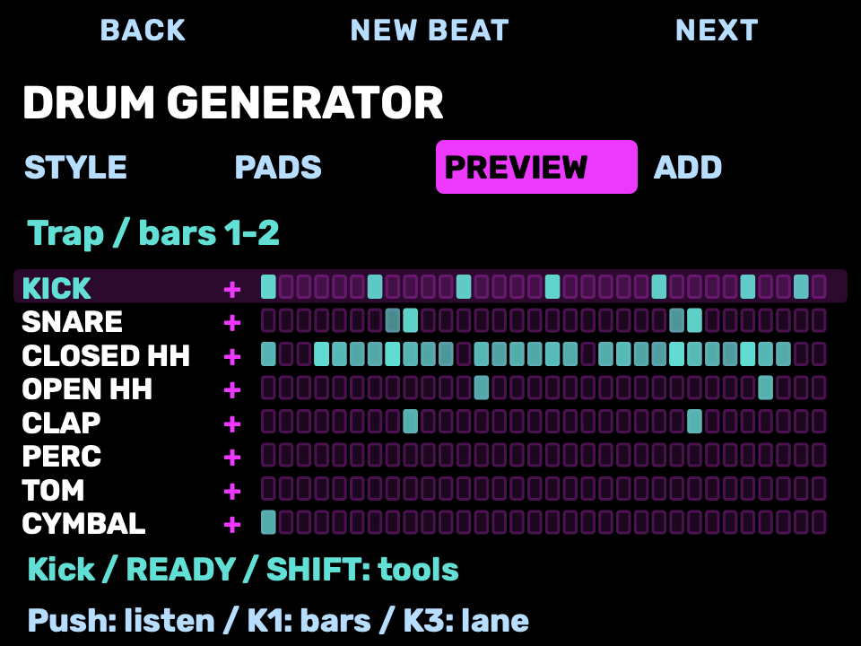

# Drum Generator

Create a genre-based drum rhythm on the MPC using your own kit sounds.
Based on Melodee by **Kerem Kiliç (Ellic Studio)**.

## 1. Open a drum kit Roll

Select a sampler/drum kit track with 16 Levels off, use a **4/4** project,
and stop recording. Open its **Roll**, push **Data** for Roll Actions and
choose **DRUM GENERATOR**. A frozen track must be unfrozen first.

## 2. Choose the style

The **Style** page contains **Genre, Loop length, Density, Swing, Fills and
Variation**. Use **K1** to select the setting and **Data/K2** to change it.
**B3** advances through the fields. Push or **B2** generates a new beat.

## 3. Pick the sounds

On **Pads**, follow the prompt: kick, snare, closed hi-hat, open hi-hat,
clap, percussion, tom and cymbal. Push Data on a sound field to open
**Sample Select**, choose a sample and return to the generator. **B3 Next Drum**
moves to the next role; **K3** chooses a role directly. **B2 Auto Map** tries
matching the loaded samples by name; check the assignments yourself.

The sounds are samples already loaded or chosen through Sample Select.
Generating the beat does not download a drum kit. A lane needs a sound to be heard.
Lock useful lanes before generating alternatives so their rhythm can be retained.

## 4. Listen and adjust

On **Preview**, push Data to audition. **K1** selects the displayed bars and
**K3** selects a drum lane. The grid shows kick, snare, hats and the other roles.
Use the page's Shift tools for lane actions; the on-screen button labels show
what is available. Stop project playback to audition a generated rhythm.

## 5. Add the beat

Continue to **Add**, then push Data or **B3 Review**. If the destination already
has notes, choose **Cancel**, **Keep + Add** or **Replace Roll**. Review this
choice before confirming. The notes are placed directly in the drum Roll;
there is no required SD export/import step. Save your project afterwards.

Screenshots are native UI renders with demonstration data. Their pad assignments
and genre are examples, not an automatic sound kit supplied by the generator.
