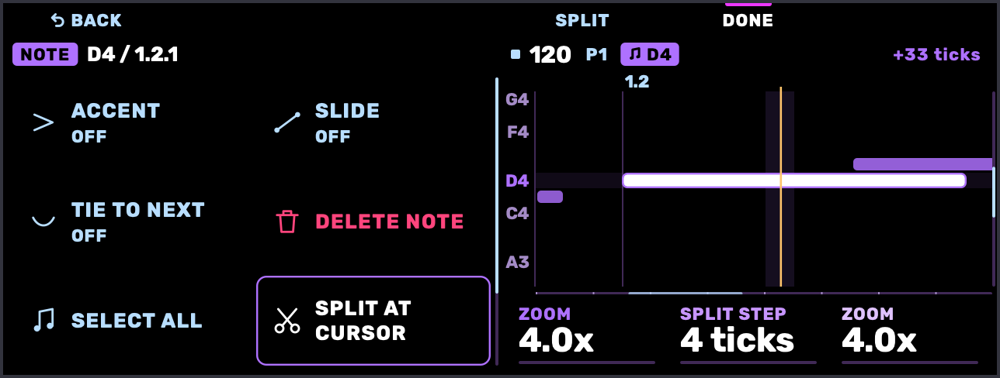
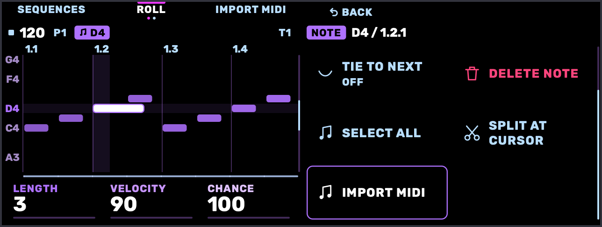

# Roll note tools

Tape Workshop extends Melodee by Kerem Kiliç (Ellic Studio). Open **Roll** with
**B2** on a sequence page, or **SEQ held + B2**. It edits the selected track's
current pattern.

## Navigate and select

Turn **Data** to focus notes, including notes within the same grid step. **− / +**
move among notes/pitches. A focused note is edited with the usual cards:
**K1 length, K2 velocity, K3 chance**. Press **B2** again for the TRIG cards.

Push **Data** to open the actions sheet. Turn Data to choose an action and push
again to apply it. **B1** closes the sheet. The actions include Accent, Slide,
Tie to Next, Delete Note, **Select All**, **Split at Cursor** and **Import MIDI**.

Use **Select All** to mark the pattern's notes. Marked notes can be moved or
edited together; Erase deletes the marked notes. A Shift tap clears the marks.
See [Sequencing](sequencing.md) for Melodee's complete note-selection, copy,
paste and recording controls.

## Zoom

Hold **Shift** and turn **K3** to zoom in or out. Release Shift to restore K3's
normal job. Zoom remains at the chosen level and also works during splitting.
Zoom changes the view, not the notes' timing.

## Split a note precisely

1. Focus the note and push **Data**.
2. Choose **Split at Cursor**.
3. Turn **K2** to choose **1, 2, 4, 6 or 8 ticks**, or a musical division.
4. Turn **Data**, or press **− / +**, to move the split cursor by that increment.
   **K1** changes zoom here; Shift + K3 also works.
5. Press **B1** or push **Data** to split at the cursor. The new right-hand piece
   becomes focused. Split mode stays open so you can continue fine adjustments.
6. Press **B2 Done** when finished. Turn Data to select either piece and edit it
   with the normal note cards. Very short notes or a cursor on the note boundary
   cannot produce another valid split.

Native UI renders with example notes: choose the split action on the left;
the persistent split view on the right shows zoom and the tick increment.

## Ratchet and triplet repeats

With notes marked, **Note Repeat** cycles their ratchet through **1, 2, 3, 4, 6,
8 hits**. The TRIG cards also edit ratchet and velocity ramp. Three hits subdivide
that note into three repeats; this is not a separate Make Triplet command and does
not change the whole project's time signature. Use the timing/division controls
when you need a triplet grid.

## Import a MIDI file

1. Select a track with a sound: a loaded drum kit, keygroup or plug-in instrument.
   MIDI is note data; it does not include the instrument or its samples.
2. Put the `.mid` file on the SD card. You can upload it with the browser's
   **Files** page, then browse to that location on the MPC.
3. In Roll, hold **Shift + B3** (**Import MIDI**), or push Data and select
   **Import MIDI** from the actions sheet.
4. Browse to the file. Press **Data** to import into an empty pattern. If notes
   already exist, choose **B3 Replace MIDI** to replace them.
5. The file picker returns to Roll after a successful import. Audition the result on
   the MPC. Use **Shift + −** to undo the import if needed, then save the project.

The import targets the selected pattern; it is not a complete DAW-project import.
Files larger than **8 MB** are rejected. Unsupported or note-free files report an
error rather than creating an instrument. Drum note numbers need to match the
kit/pad mapping you intend to use.

Native UI renders with example notes: **left**, Shift exposes the MIDI-import
shortcut; **right**, Import MIDI is selected in the actions sheet. These are
rendered examples from the current page code, not a physical-device capture.

## WAV-to-MIDI generation

From a melodic instrument track's Roll, press Data, choose **MIDI GENERATOR**
and press Data again. Choose WAV sample as Source and select the loaded WAV's
track and pad, then choose Chords, Bass Line, Pluck, Melody or Hybrid. Follow
Output → Target → Preview → Add. Existing destination notes offer Cancel /
Keep + Add / Replace. See the [full WAV-to-MIDI walkthrough](wav-to-midi.md) for
source selection, BPM, genre/scale/rhythm, bass octave, screenshots and troubleshooting.
