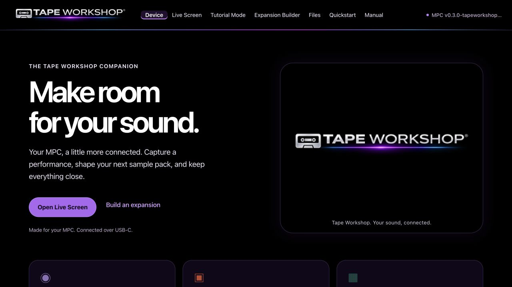
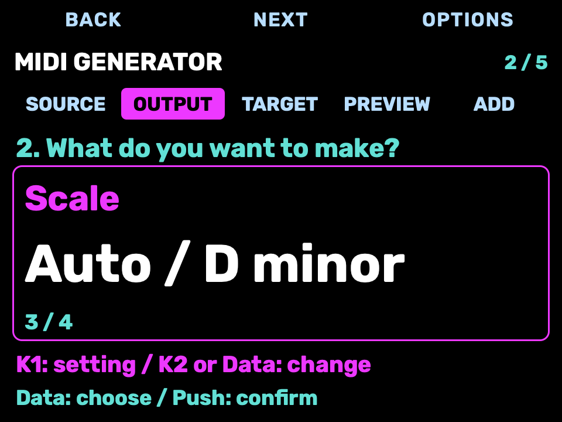
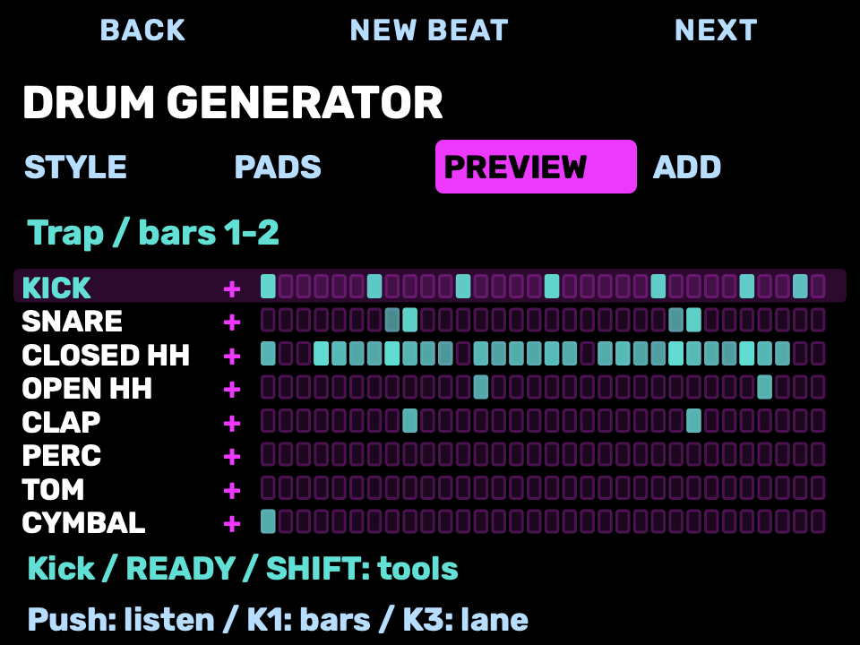

# Tape Workshop features

Tape Workshop builds on **Melodee by Kerem Kiliç (Ellic Studio)**. This chapter
covers the additions available in Tape Workshop v106 (Melodee v0.5.1 base). The remaining manual
chapters explain the inherited sampler, sequencer, mixer and recording controls.

## Melodee v0.5.1 base update

v106 merges Melodee v0.5.1 while retaining Tape Workshop's Roll tools, native
plug-in visuals, expansions, themes, startup lighting, signed updater and browser
companion. Studio/the browser DAW remains removed.

The base update adds improved Chop tools (pad slicing, slice playback choices and
bank navigation), sample root-note handling, kit-bank loading, updated auto
sampling and stem separation, and sequencing/transport fixes. **Settings → AUDIO
→ USB volume** selects Full or Knob for USB-C's stereo main mix. Existing saved
projects/settings remain supported; keep a backup before updating.

New recorded/edited samples use **Melodee/Samples** by default. The older root
**Samples** folder remains readable, and Tape Workshop's custom sample-folder
selection remains available. Rec Quantize now follows the selected pattern's Q,
as in Melodee v0.5.1; Roll split increments are a separate, unchanged control.

## Start here

| I want to… | Where to go |
| --- | --- |
| Bring a MIDI file into a pattern | [Roll: MIDI import](roll-note-tools.md#import-a-midi-file) |
| Select all notes, zoom or split a note | [Roll note tools](roll-note-tools.md) |
| Choose the black and purple look | [Workshop themes](workshop-themes.md) |
| Install a pack, bank or individual pad | [Expansions and pads](workshop-expansions.md) |
| Make a pack with eight banks and cover art | [Expansion Builder](web-studio.md#expansion-builder) |
| Watch or record the MPC screen | [Live Screen and Tutorial Mode](web-studio.md) |
| Install a signed update | [Updates](projects-and-files.md#update-tape-workshop) |
| Use plug-ins on another Melodee build | [Portable plug-ins](portable-plugins.md) |

## Roll editing

Roll keeps Melodee's navigation and adds **Select All**, **Split at Cursor** and
**Import MIDI** to the Data-push actions. Hold **Shift + K3** to zoom. Split mode
stays open until **B2 Done**, with 1, 2, 4, 6 and 8-tick cursor increments as well
as musical divisions. Split halves are individually selectable. Ratchet remains
available; there is no separate Make Triplet action.

MIDI import loads note events into the selected track's current pattern; it does
not install an instrument or turn a MIDI file into audio. Choose a track with a
sound before importing.

## Themes and lighting

The **Workshop theme** setting offers retro LCD looks, 8-Bit, high-contrast color
schemes and **Tape Workshop Neon**. Neon uses black surfaces, bold white text and
purple/magenta controls. The browser companion uses black with purple, magenta and
cyan accents from the logo; changing the OS theme does not recolor the browser.

On startup, all 16 pads perform a purple/magenta wave while the logo appears.
Normal lighting returns when the splash ends. **Settings → PADS → Boot light
show** enables or disables it for the next startup. Physical kit pads follow
their track color, including when pressed. Recording/mute warnings remain red;
the Pad lights setting can still choose white or off. Imported per-pad colors
remain stored in the project even though physical kit lights follow the track.

## Packs, banks and pads

Expansion Builder offers **banks A–H, 128 pad slots**, cover-photo import, mouse/
touch audition and physical MPC-pad triggering of the selected browser bank.
Export to the SD card's **Expansion Packs** folder with **Save to MPC**, or use
**Download a copy** for your phone or computer. The OS expansion browser supports
cover artwork, loading kits/banks and importing a single pad. **Import Pad →
Empty Pad** creates a blank pad without loading a sample.

## Browser companion

Connect USB-C and open **http://192.168.155.1/**. Device, Live Screen, Tutorial
Mode, Expansion Builder, Files, Quickstart and Manual are available. **Studio /
the browser DAW is removed**. Use the MPC's Roll, sequences and Song page for
project editing and arrangement.

Live Screen and Tutorial Mode can record the screen with direct stereo MPC audio.
With browser disk buffering, a take can run up to **2 hours**, subject to
free browser storage and the recording size limit. The fallback is **20 minutes
or 768 MiB**. **Pause recording** skips time; Resume continues the same take.
Save the finished recording before starting another. Use the inspector for
independent MPC/screen zoom, pan and screen angle, tablet framing, imported
backgrounds, animated scenes and the audio-reactive waveform.
See [Tutorial recording](web-studio.md#tutorial-recording-duration).

Local browser preview; no MPC is connected in this screenshot.

## Prism EQ and plug-in screens

Tape Workshop adds native live visuals for supported plug-ins. Prism EQ can show
frequency activity and overlap information; hold **Shift** on its effect view to
see the overlapping track/pad sources and frequency ranges. After playback stops,
the last overlap reading is retained for inspection. See [Prism EQ](plug-ins.md#tape-workshop-live-screens-and-prism-eq).

Colored overlap/balance indicators are mixing aids, not a guarantee that a mix
sounds balanced. Compare by ear, adjust levels and EQ in context, and watch the
master for clipping.

Compatible Linux ARM plug-ins load from **Melodee/Plugins**. The separate SD-card
plug-in installer copies those files without replacing the OS. Tape Workshop's
custom screens are part of its host; installing a plug-in onto official Melodee
does not install those screens. No desktop AU/Windows conversion is performed.

## MIDI and Drum Generators

[MIDI Generator](wav-to-midi.md) uses a loaded WAV, existing Roll MIDI or the
project key. The five guided stages are Source, Output, Target, Preview and Add.
Outputs are Chords, Bass Line, Pluck, Melody and Hybrid. From v182, confirming
a WAV source pad estimates its key automatically before note generation.

[Drum Generator](drum-generator.md) guides you through genre, sound assignments,
rhythm preview and direct Roll placement. The Pad page opens Sample Select for
each drum role. Keep + Add / Replace is reviewed before changing existing MIDI.

