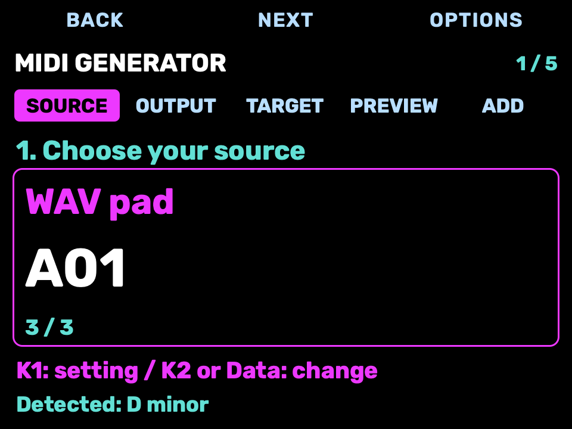
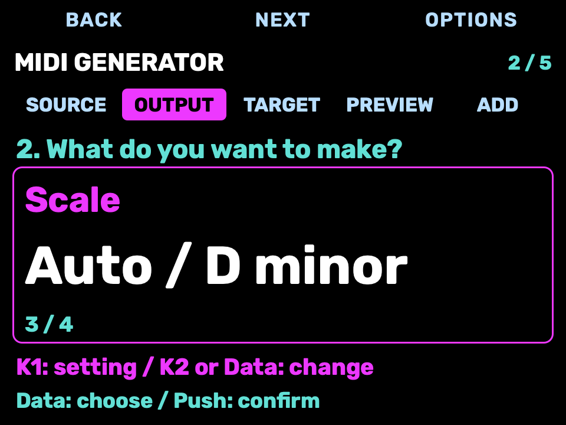
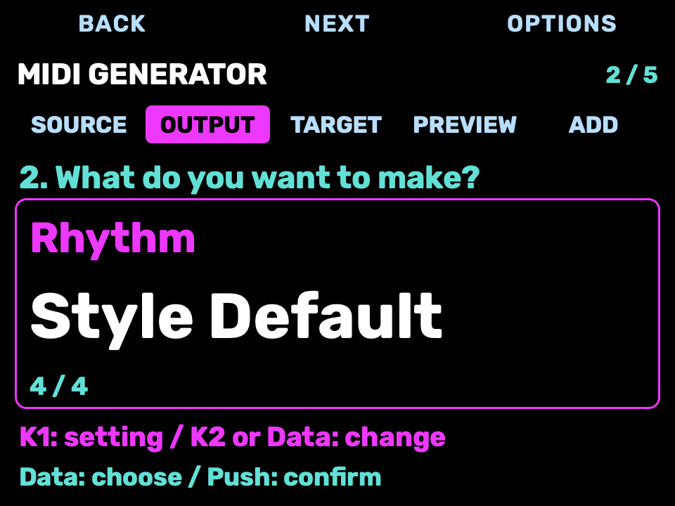
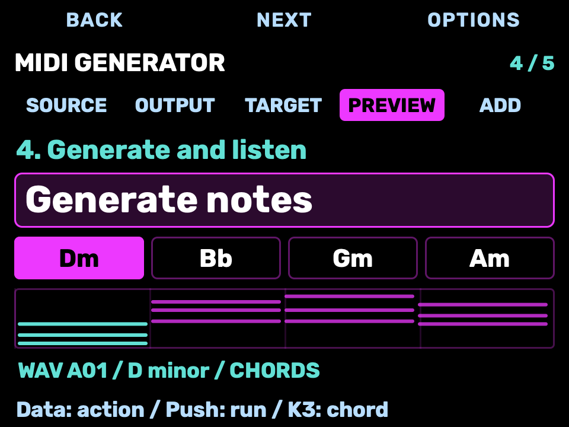
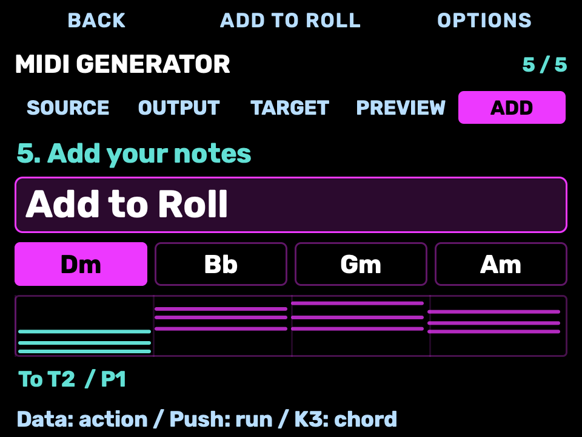
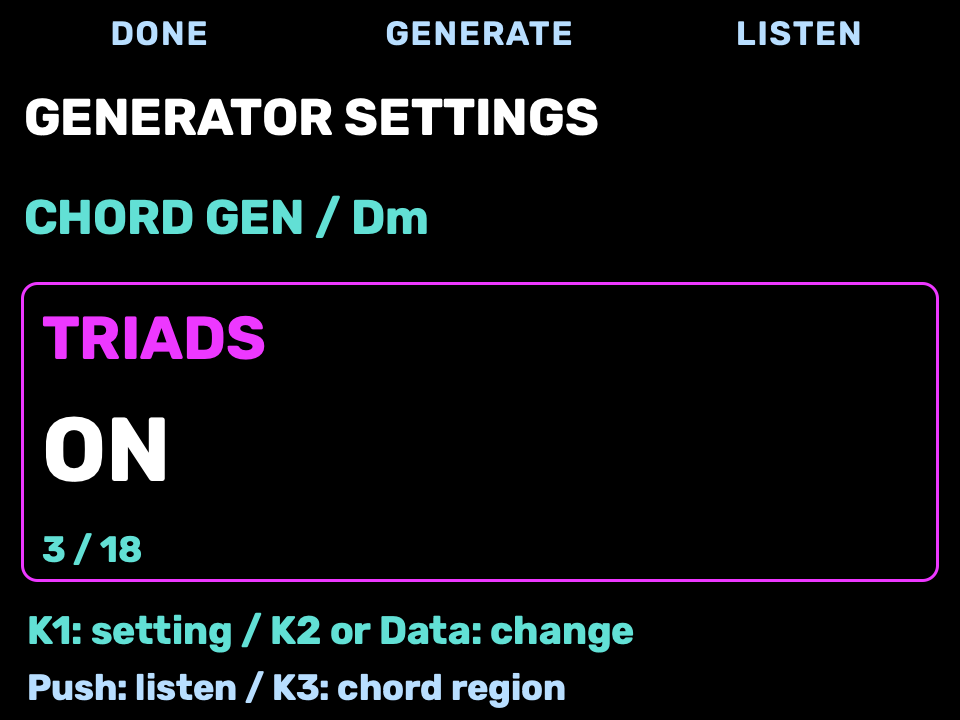

# WAV to editable MIDI — Tape Workshop

Turn a loaded WAV's harmony into editable **Chords, Bass Line, Pluck, Melody or
Hybrid** notes on the MPC Sample. Hybrid combines chords and melody, without bass.
This runs on the unit; a computer is not needed to generate the notes.

Tape Workshop by bsauce42, based on **Melodee by Kerem Kiliç (Ellic Studio)**.

## 1. Install the complete build

Use the complete **Tape-Workshop-v<version>-SD-Card.zip** supplied with your
release. This guide covers the guided generator, including automatic key
preview introduced in **v182**. Check the running version on the browser's
Device page; some screenshots show features unavailable in older builds.
This is the only ZIP needed for SD-card installation. It contains `autorun/` and
`Melodee/Plugins/`, including all **26 Tape Workshop plug-ins**, their resources
and license notices. The separate source archives are for your computer.

1. Save your project, power off the MPC and connect its SD card to your computer.
2. Back up the existing `autorun` and matching plug-in folders.
3. Replace the card-root `autorun` folder. Merge the included `Melodee/Plugins`
   with the card's `Melodee/Plugins`, replacing the bundled plug-in files.
4. Keep your projects, samples, user presets and other third-party plug-ins.
5. Eject the card, put it back in the MPC and start Tape Workshop. This build
   targets MPC Sample firmware **1.3.0.12**. Refresh the companion browser after updating.

## 2. Load the WAV and set the tempo

1. Select a sampler/drum track and a pad, then open **Sample Select**.
2. Load the WAV you want to use. Remember its **track number and bank/pad**,
   for example Track 1 / A01. The source and destination do not need the same bank.
3. For a rhythmic WAV, turn **Auto BPM on with K2** before loading. Review the
   detected tempo and choose **Use WAV BPM** to set the project/sequence tempo.
   BPM text in supported filenames helps detection. You can also set BPM manually.
4. Match the tempo before analysis: audio seconds are placed on the MIDI grid
   using the current project tempo. A wrong tempo means a mismatched Roll length.

## 3. Choose the destination instrument

Select an unfrozen melodic instrument track and load the sound you want to hear:
for example a piano/Strings plug-in for chords, a bass preset for bass, or a
plucked sound for Pluck. The generator makes MIDI notes; the target instrument
makes the sound. A plain Audio track is not a destination.

Open that track's **Roll** (B2 on a sequence page, or hold SEQ and press B2).
Press the **Data knob** to open **Roll Actions**, turn it to **MIDI GENERATOR**,
then press Data to open the generator.

## 4. Follow the setup pages in order

Each setting has its own screen with a large value. **Data or K2** changes the
value, **Push or B2 Next** confirms, and **B1 Back** returns to the previous
setting. **K1** selects a field; **B3 Options** opens advanced settings.

1. **Source:** choose **WAV sample**, then the exact **WAV track** and **WAV pad**
   holding your file. Check the source filename; selecting a different instrument
   track does not automatically make that instrument the WAV source.
2. **Output:** choose **Chords**, **Bass Line**, **Pluck**, **Melody** or **Hybrid**.
   Continue through **Genre**, **Scale**, and **Rhythm**. For source-led harmony,
   leave Scale at **Project/Auto** (shown as **Auto / WAV** for a WAV source).
   From v182, confirming the WAV pad starts automatic key detection. Scale shows
   the estimated root, such as **Auto / D minor**. An explicit scale uses that
   detected WAV root; it does not change the project root.
3. **Bass octave** appears for Bass Line: choose **C1 Low 808** or **C0 Extra low**
   for lower MIDI notes, with a bass/808 sound on the destination instrument.
4. **Target:** select the instrument track that will receive the generated notes.
5. **Preview:** select **Generate notes**, then press Data. Whole-WAV analysis
   displays progress and can be cancelled with B1. Automatic key preview does not change the Roll; Generate notes remains
   the action that prepares the output part.
6. **Listen to region** auditions the selected chord region. K3 chooses a region.
   Use **Try another** for another phrase/variation; WAV chord/bass analysis may
   instead offer **Reanalyse WAV**. Press Next when you are happy with the result.

These are native UI renders with demonstration data, not a recording of analysis
of a particular file. The D minor estimate illustrates automatic key preview.

## 5. Add the notes directly to the Roll

On **Add**, select **Add to Roll** and press Data, or press **B2 Add to Roll**.
There is no need to export a file to the SD card and import it again.

If the destination already contains MIDI, choose:

- **Cancel** — leave the Roll unchanged.
- **Keep + Add** — preserve its existing notes and add the generated notes.
- **Replace** — replace that destination's notes with the generated notes.

The source WAV is not changed. Save your project to keep the generated Roll.
An optional **Save MIDI copy** / **Shift+B3** saves generated notes as a MIDI
file; it does not include the source WAV audio or unrelated tracks.

## Make another part without starting over

In **Roll Actions**, use **Generate Again** to reuse the previous setup, including
the selected source and output settings. **Generate From Roll** uses the current
Roll's notes as the MIDI source. Set a separate destination if you want to preserve
the original notes, and review Keep + Add / Replace carefully.

You can also start without a WAV: choose **Project key / scale** as Source and
set the root/scale, loop length, output, genre and rhythm. To follow imported MIDI
on another pad/track, choose **MIDI Roll** and select its track, pattern and pitched
pad lane when applicable.

## If the result needs adjustment

- **Wrong WAV:** return to Source and check WAV track, bank/pad and filename.
- **No sound:** load an instrument on the target track; MIDI notes have no sound
  on their own. Check mute, level and the chosen octave.
- **Timing mismatch:** correct project BPM and time signature, then generate again.
- **Missing or extra ending bars:** compare the actual file length, tempo and any
  silence/fade at the end. The analyser retains partial final windows; Roll length
  rounds to a bar. This is not the same as extending audio past its real ending.
- **Harmony sounds wrong:** WAV key/chord detection is an estimate. Clear tonal
  material works best; drums, detuning and complex mixes can be ambiguous. Try
  another scale, voicing or rhythm and edit the generated notes in the Roll.
- **Too long:** the current Roll has a 128-bar limit. Trim a copy or use a shorter
  source if its duration at the selected BPM exceeds that limit.

This feature recognises harmonic changes through the whole original WAV and
creates musical MIDI parts from that analysis. It is **not exact transcription
of every audible note**, a stem separator, or an audio-to-sampler conversion.

## Automatic key detection when selecting the WAV

Confirm **Source → WAV sample → WAV track → WAV pad** with Data/Next.
The generator analyses the WAV in the background immediately and shows an
estimated key, such as **Auto / D minor**, on the Scale page. No separate
Generate action is needed to detect the key. Your project root stays unchanged.
Choosing a different scale uses the detected WAV root. Select another WAV pad
and confirm it to analyse a different source. Silent or ambiguous audio may
not produce a reliable key; review the estimate before generating.

**Generate notes** remains a separate action on Preview. Key detection alone
does not add, replace, or audition notes in your Roll.

## Simple chords and single-note parts

For simple three-note chords: **Output → Chords**, then **B3 Options**.
Use **K1** to select each setting and **Data/K2** to change it:
**Triads ON, Sevenths OFF, Ninths OFF**. Press **B1 Done** to return.

**Whole Notes** is a rhythm choice; it does not turn a chord into a single note.
A triad has three simultaneous notes. **Bass Line** makes a monophonic part;
**Held Roots**, **Whole Notes** and **Gate 100%** give sustained roots. Chord
changes in the source can still cause additional notes inside a bar. To guarantee
exactly eight notes, review the resulting Roll and keep one event per bar.

For WAV/MIDI input, **Options → Follow → Every Bar** sets bar-based harmony
analysis. **Follow** is hidden for **Project key / scale** input. When starting
without a file, set the project root on Keys: hold **SAMPLE**, turn **K1** for
root and **K2** for scale; return to the generator and choose 4 or 8 bars.

**Generate Again** retains the previous setup. **Generate From Roll** reads
existing MIDI. Both are Roll Actions; neither requires choosing the file again.

## Hip-hop and trap melody ideas

In MIDI Generator, choose **Melody**, **Pluck**, or **Hybrid**, then select
**Hip Hop** or **Trap** under Genre. Leave Rhythm on **Genre Auto** for the
motif composer: short repeating hooks, rests, answering phrases and small
turnarounds. It follows the detected or selected harmony; weak melody notes
can connect through the selected scale. Pluck stays on chord tones.

Start with **1/4** for a sparse melody, **1/8** for more motion, or **1/8T**
for triplet phrasing. Adjust Octave and Gate to suit the instrument.
**Generate Again / Variation** creates another idea using the same source.
A manually selected rhythm still controls the exact hit positions.

Listen first, then add the result to the Roll. The existing **Keep / Remove**
prompt protects notes already there. Source WAV analysis and MIDI-pad selection
work as before. Hybrid adds chords and melody; it does not add a bass part.

For Hip Hop and Trap, **Pattern** offers four distinct phrase feels:

- **Hook**: a short recurring idea with gaps.
- **Rolling**: more continuous note movement.
- **Dark** (Trap) or **Soulful** (Hip Hop): syncopated phrases and answering notes.
- **Space**: fewer, longer gestures.

Leave Rhythm on **Genre Auto** to hear each Pattern's own timing. An explicit
rhythm still keeps the hit positions you chose. These are original generated
phrases, not transcriptions of a reference loop.

## Default Bass Line setup (v195)

New MIDI Generator setups start Bass Line with **Held Roots**, **Classic 808**,
**C1 / Low 808**, and **100% Bass Gate**. This favors sustained roots with short
pickups. Previously remembered generator setups keep their selected values.
Choose an 808 instrument/preset on the target track to supply the sound.
