# Workshop themes

Tape Workshop builds on Melodee by Kerem Kiliç (Ellic Studio).

## Choose a theme

Open **Settings** with **Shift + Pad 8**, go to **SCREEN**, then choose **Workshop
theme**. Turn the selected setting to preview and choose a look. The setting is
remembered across projects and restarts; installing an update preserves the
existing theme choice. **Off** restores the normal Palette selection.

**Palette** and **Font** are separate choices. A Workshop theme overrides its
screen colors while active. Tape Workshop Neon forces bold text for readability;
other themes retain their existing typography. These settings change the OS
screen, not your project audio or the browser's independent black logo-color style.

## Available looks

| Theme setting | Appearance |
| --- | --- |
| **Off / Melodee Night** | Default Melodee palette; selecting Off restores the Palette setting. |
| **MPC60** | Green LCD background and dark ink. |
| **MPC2000** | Blue LCD background and light text. |
| **MPC5000** | Pale LCD background and purple ink. |
| **MPC Sample** | Black with yellow and light controls. |
| **MPC XL** | Dark gray surfaces and pink accent. |
| **8-Bit** | Purple pixel-style look with mint accent. |
| **Black & Yellow** | Black surfaces and bright yellow text. |
| **Hot Green & Purple** | Purple background with hot-green accent. |
| **Hot Green** | Hot-green background and dark-purple ink. |
| **Tape Workshop Neon** | Solid black, bold white text and purple/magenta track controls. |

## Theme screenshots

The following native UI renders use the same example notes in every theme.
Left: Roll with Shift held. Right: the MIDI-import action. They show the current
screen rendering code; they are not photographs or captures from connected
hardware. Demo note positions are illustrative.

### Off / Melodee Night

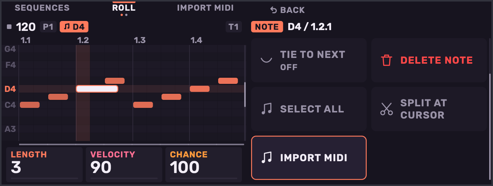

### MPC60

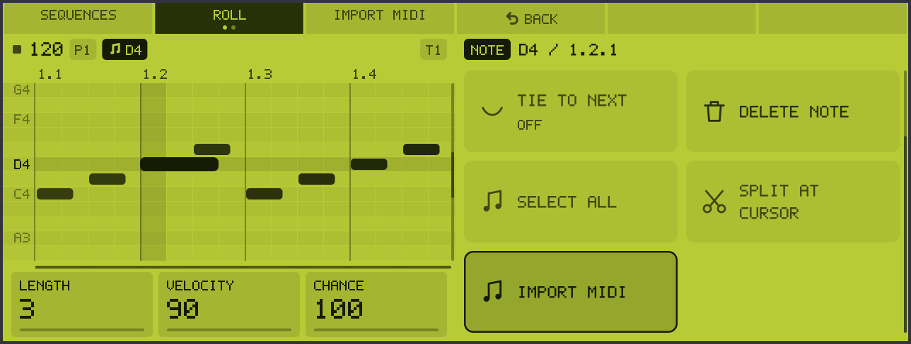

### MPC2000

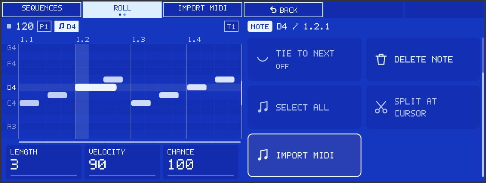

### MPC5000

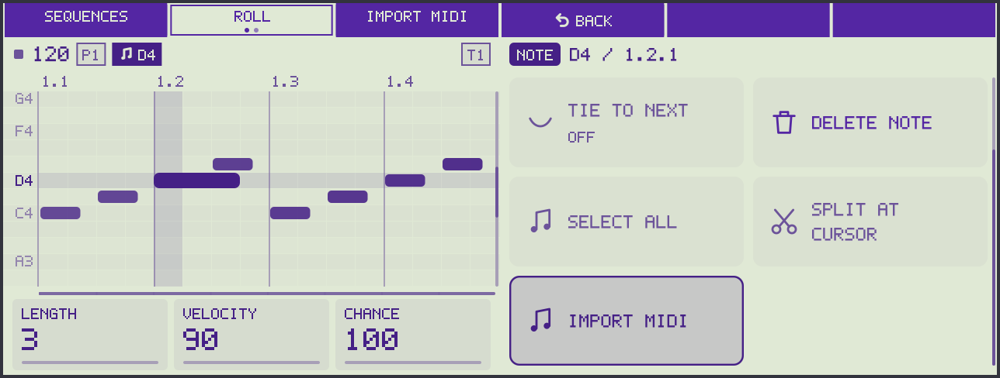

### MPC Sample

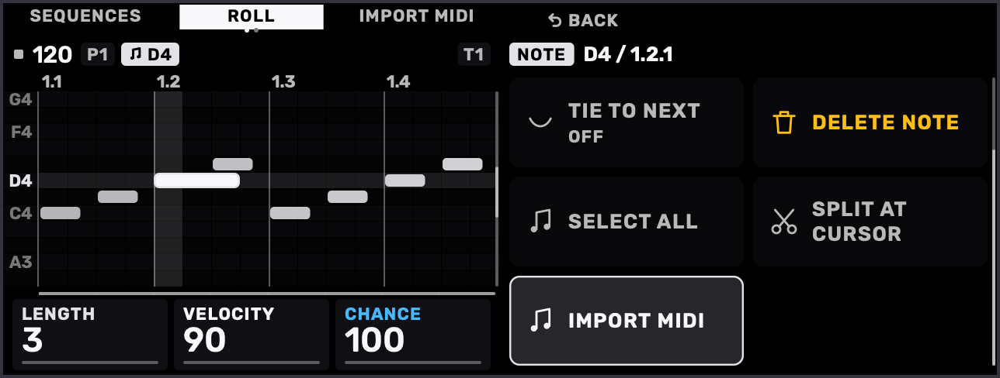

### MPC XL

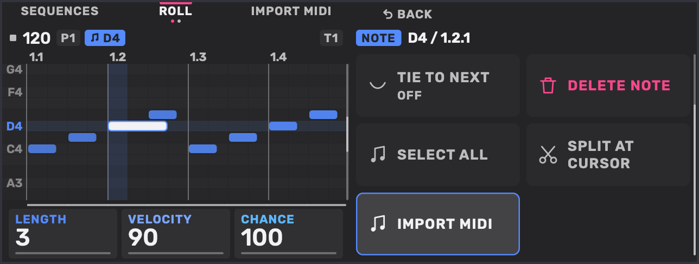

### 8-Bit

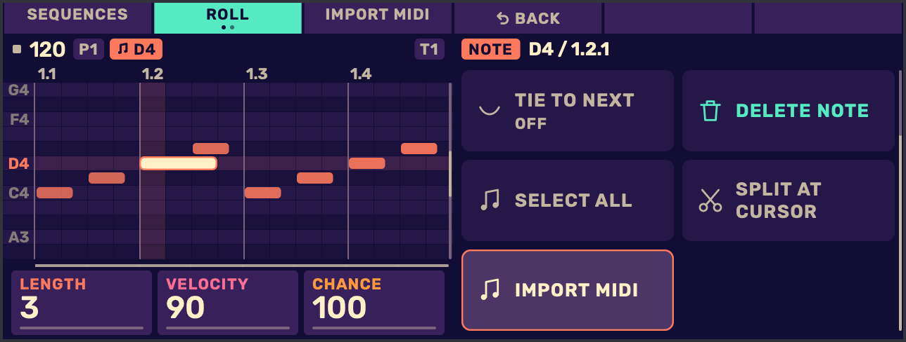

### Black & Yellow

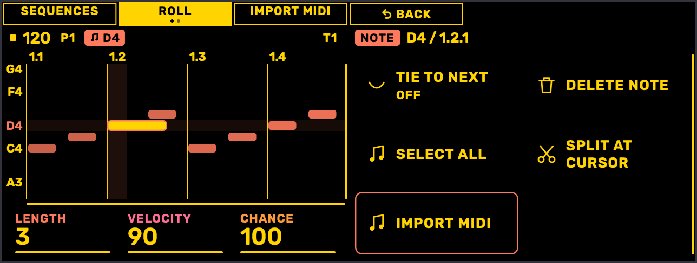

### Hot Green & Purple

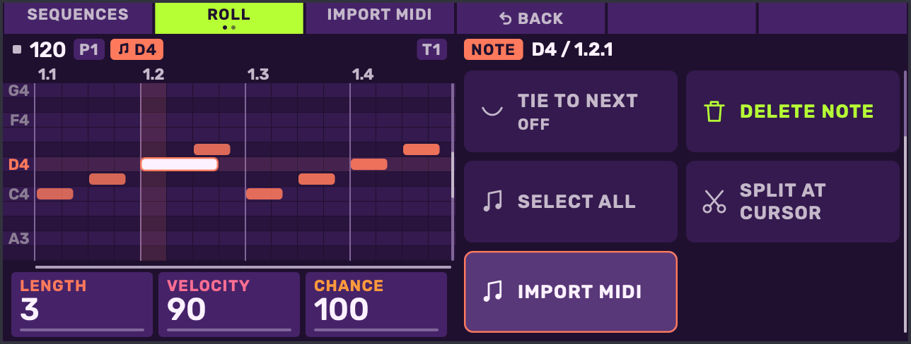

### Hot Green

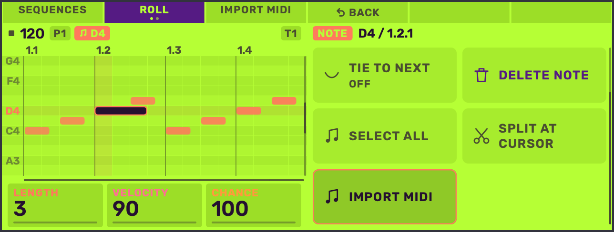

### Tape Workshop Neon

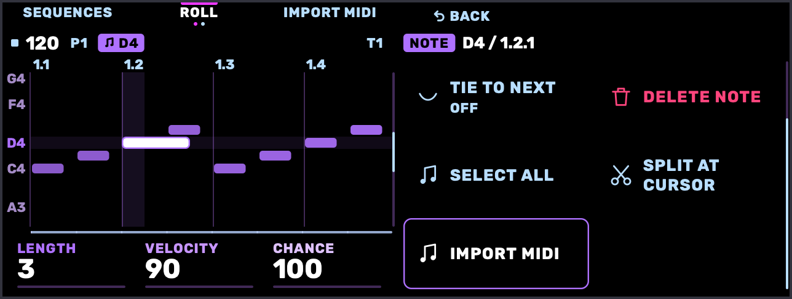

## Pad lights and startup

In **Settings → PADS**, choose **Pad lights**: track colors, white or off.
Playable kit pads follow their track color, brightening when pressed instead of
switching to white. Tape Workshop Neon shares its purple/magenta track palette
between the screen and LEDs. Recording and mute warnings remain red. Imported
per-pad colors remain stored in project data.

**Reactive pad lights** adjusts brightness with strike intensity and sustained
sample activity. **Pad fade** controls the fade after a sound stops. **Boot light
show** enables the all-16-pad purple/magenta wave during the startup splash; the
setting applies on the next restart. Normal pad lighting resumes when startup
ends, including when the splash is skipped.
