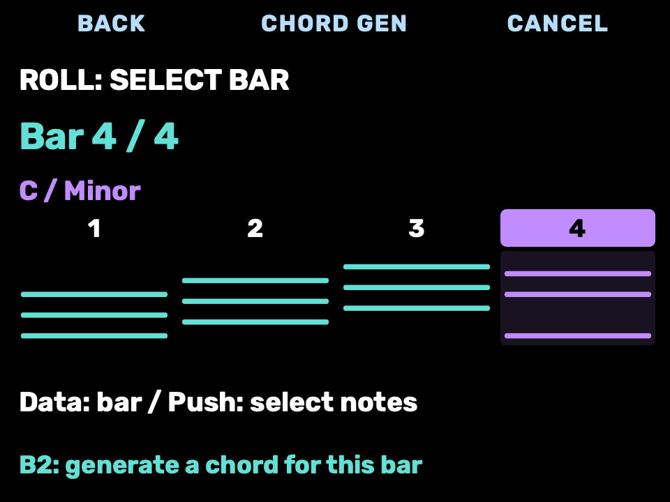
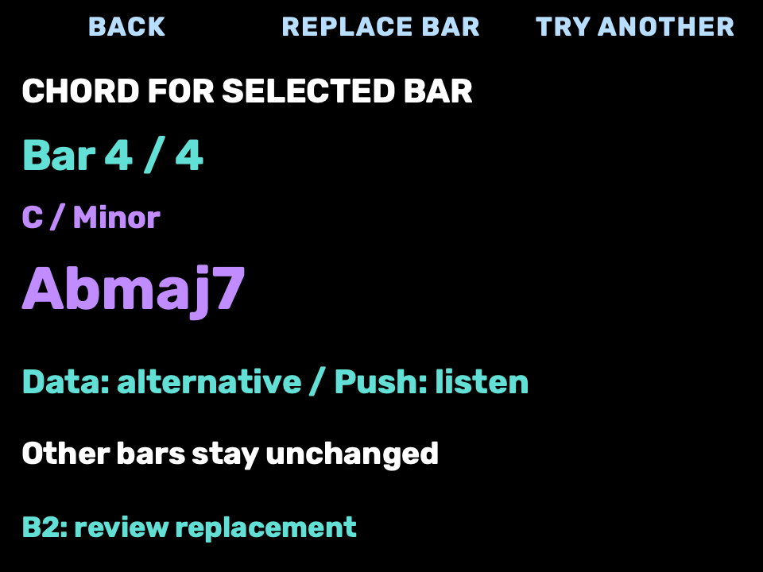
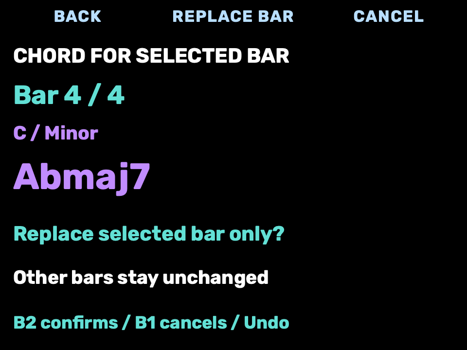
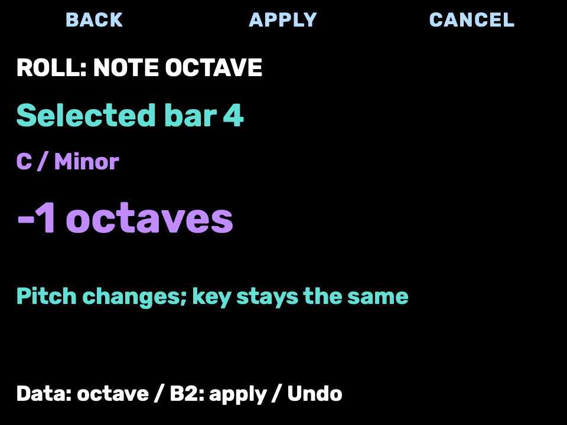
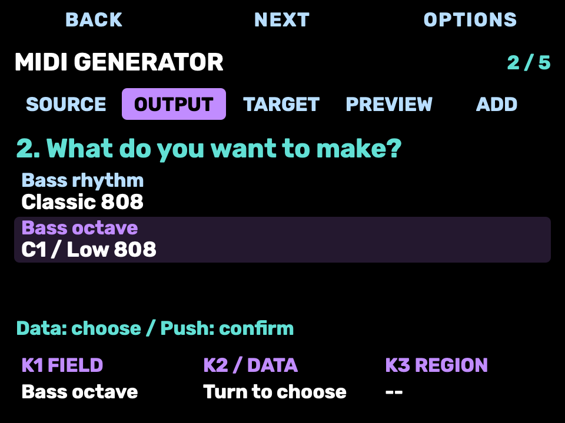
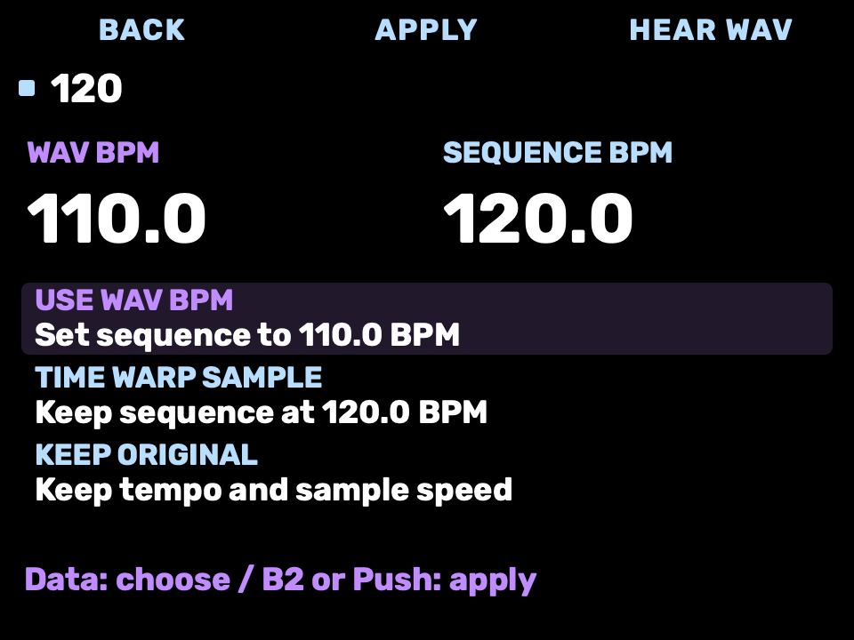

# Tape Workshop v144 — Bar Chords, Octaves and Search Fixes

Tape Workshop is based on **Melodee by Kerem Kiliç (Ellic Studio)**.

This update adds selected-bar chord editing, visible octave controls and a
clearer WAV tempo chooser. It also fixes the startup path for the bundled voice
search decoder and model. All 24 Tape Workshop plug-ins are retained.

> These images are previews rendered from the actual v144 interface, not photos
> or captures from an installed MPC. ARM compilation, model checks and screen
> text-fit checks passed. Physical v144 testing is still pending.

## Download and install

Use **Tape-Workshop-v144-SD-Card.zip** for an SD-card installation. It contains
only the `autorun` folder and `Melodee/Plugins`, including required resources and
license notices. Source archives and guides are separate downloads.

1. Save your project and back up your current SD-card files.
2. Quit the OS and connect the SD card to your computer.
3. Extract the ZIP. Merge its `autorun` and `Melodee` folders into the SD-card
   root, replacing matching build files while keeping your projects and samples.
   Copy the folders themselves, not another enclosing folder.
4. Eject the card, insert it into the MPC Sample and start the unit.

For the browser updater, use **Tape-Workshop-v144-Signed-Update.zip**, not the
SD-card ZIP. Send the signed ZIP, then confirm **B3 / INSTALL on the MPC**.
The install prompt requires a physical button press; remote controls cannot
confirm it. Allow the update and restart to finish before using the new controls.

## Select a bar and generate a chord

Open an existing melodic instrument track's **Roll → Actions → SELECT BAR**.
Turn **Data** to choose a bar. **Push Data** selects that bar's notes; **B2** opens
its chord generator directly.

The choices contain only chord tones inside the project's **Root and Scale**.
For example, C minor offers compatible minor-key chords. Change the project key
first if you want a different set of choices. Triads, sevenths and ninths appear
where every note fits the selected scale.

- **Data:** choose a chord.
- **B3 / Try Another:** next alternative.
- **Push Data:** audition the chord through the track's instrument.
- **B2:** review the replacement.

Press **B2 again** on the confirmation screen to replace only the selected bar.
Other bars remain unchanged. Notes held across the boundary are split so their
outside portions remain. **Undo** restores the previous notes. Cancel leaves
the notes unchanged. If the pattern or key changes during preview, reopen the tool.

Chord generation requires a melodic plug-in, keygroup or MIDI track. Plain drum
pad numbers are not treated as musical chord pitches.

## Change the octave in the Roll

Choose **Roll → Actions → NOTE OCTAVE**. Turn Data from **−4 to +4 octaves**,
then press **B2 / Apply** or Push Data.

- With a selected bar, only its note portions change octave.
- Otherwise, marked notes change; if none are marked, the focused note changes.
- Moving an octave preserves the notes' pitch classes and musical key.
- A shift outside the supported range, or into conflicting notes, is refused
  without a partial edit. One Undo restores a completed change.

For a sampler pad, open its pitched/16 Levels Roll first. The existing
−48 to +48 semitone pad range is respected; ordinary drum triggers are not shifted.

## Low bass and 808 registers

Open **MIDI GENERATOR → Output → BASS LINE**. Choose the rhythm, then its octave:

| Register | Label | Root-note range |
| --- | --- | --- |
| C0 | Extra low | MIDI 12–23 |
| C1 | Low 808 | MIDI 24–35 |
| C2 | Standard bass | MIDI 36–47 |
| C3 | Upper bass | MIDI 48–59 |

These describe the root register; root/fifth and octave styles can add higher
notes. The default remains **C2**. Choose an 808 or bass sound on your destination
instrument—the generator writes MIDI and does not create a new 808 sound engine.

The 24 rhythm choices from v143 remain, including quarter/eighth/sixteenth notes,
triplets, Classic 808, Trap 808, syncopation, long/short phrases and two-bar motion.
Preview can audition up to two bars before adding notes to the Roll.

## Set the sequence BPM from a WAV

In **Sample Select**, enable **Auto BPM** using Shift+B3, then load a rhythmic WAV
onto a sampler pad. When a steady tempo is detected, the dialog shows both the
WAV and sequence BPM and offers three visible choices:

| Choice | Result |
| --- | --- |
| **Use WAV BPM** | Set the normal project/sequence tempo to the detected BPM; keep original sample speed. |
| **Time Warp Sample** | Keep the sequence tempo and time-warp the sample to match. |
| **Keep Original** | Keep the current sequence tempo and original sample speed. |

Turn **Data** to choose. **B2 or Push Data** applies. **B3** previews the original
WAV; Shift+B3 previews warped audio.

The estimate comes from audio analysis. One-shots or sounds without a steady
pulse may have no BPM. Review possible half/double-time estimates before applying.
Existing global/per-sequence tempo mode and external clock behaviour remain.

## Voice search: decoder startup fix

Earlier startup workers left the voice bundle on the SD card without copying it
to the runtime location used by search. This update copies and verifies the
bundled decoder, acoustic model and keyword files before the OS starts.

1. Stop playback/recording and turn input monitoring off.
2. Open Sample Select on a sampler track.
3. Hold **Shift+B2**, say a supported keyword such as **kick**, **snare** or
   **piano**, then release.
4. Check the resulting search text and matches.

Voice search uses the supported keyword vocabulary; it is not unrestricted
English dictation. A word spoken into the physical MPC microphone is needed to
confirm recognition on the installed device.

## Validation and credits

Checks cover all root/scale chord-tone constraints, preservation of outside-bar
notes, octave limits, pitched pads, bass registers, existing output generation,
MIDI reimport, guarded edits and startup-resource packaging. These checks do not
replace a hardware listening and recognition test.

Based on **Melodee by Kerem Kiliç (Ellic Studio)**. Existing source and license
notices are retained. Corresponding OS and plug-in source archives are supplied
separately from the SD installation ZIP.
